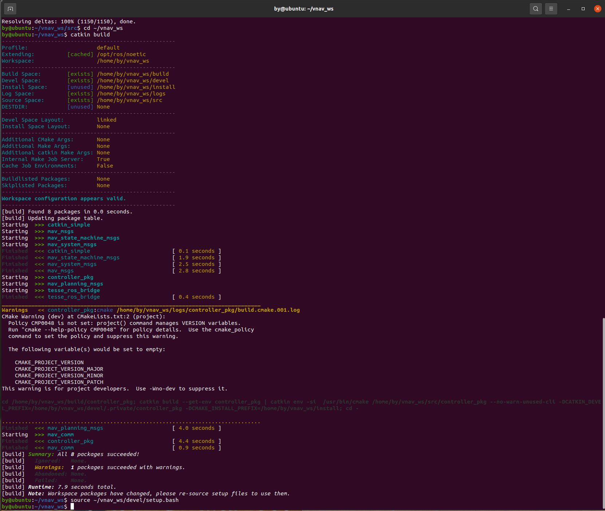
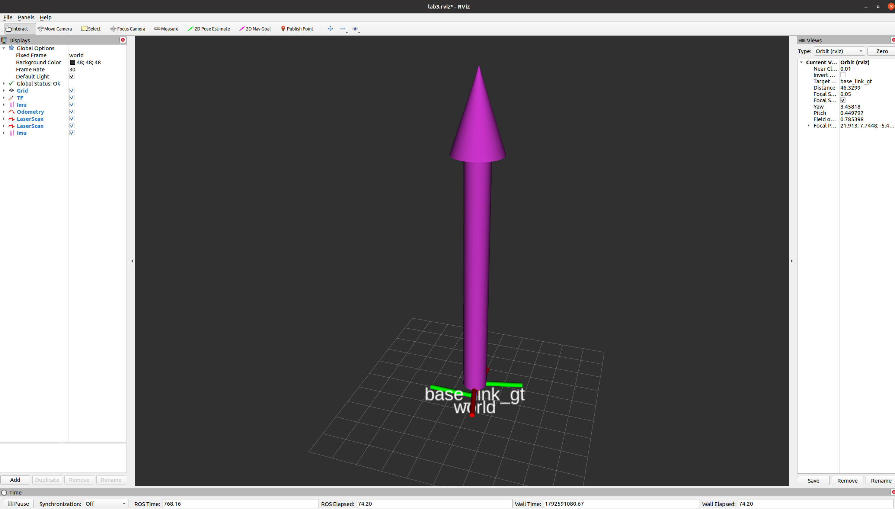

VNAV: Visual Navigation Laboratory

Lab 3: Quadrotor Trajectory Generation and Tracking

Huang Boyu | Student ID: 24020036026 | Group 8
Class 1, Chinese-Foreign Cooperative Computer Science Programme
Lab date: 21 October 2026. Report date: 23 October 2026.

### Summary

The 11 missing controller blocks were completed and tested in Ubuntu 20.04 with ROS Noetic. The vehicle first hovered, then followed a circle of 5 m radius at 2 m height. Early gains caused flips; lower attitude feedback and revised position and velocity feedback removed the obvious sway. A 44.64 s recording yielded 2,233 aligned position samples, a 3D position root-mean-square error (RMSE) of 0.1052 m, a maximum error of 0.1166 m and a yaw RMSE of 9.524 degrees. All eight original screenshots are included alongside the code, plots and theoretical work. Drag compensation was derived but was not used in the flight code.

## 1 Introduction: What the Experiment Addresses

To accelerate sideways, a quadrotor normally tilts so that thrust has a horizontal component. Position and attitude therefore have to be controlled together. The controller repeatedly compares the reference and actual state, calculates the force and turning moments needed, and distributes them to the four rotors.

Table 1. Laboratory tasks

| Task | Work completed |
| --- | --- |
| D1 | Five interface questions on attitude conversion |
| D2 | Rotor-configuration analysis and drag-compensation derivation |
| D3 | Controller completion, tuning, hovering and circle tracking |

The work follows the 2023 Lab 3 exercises and the VNAV2021 project [1,2]. The reference trajectory is provided; a new path-planning algorithm is not required. The report follows the supplied template: introduction, set-up and procedure, results, discussion, conclusions and references.

### 2.1 Environment and Directories

The system and source directories were checked before building, so later commands used the intended workspace. ROS provides communication between programs; catkin builds the source into runnable nodes. Figure 1 records the actual checks.


Table 2. Runtime environment

| Item | Configuration | Purpose |
| --- | --- | --- |
| System | Ubuntu 20.04.6 LTS in VMware | Runs ROS and the simulator |
| ROS | Noetic | Transfers states and commands |
| Source | VNAV2021 | Provides controller template and trajectory publisher |
| Workspace | ~/vnav_ws | Stores source, build products and setup files |

~/labs holds the downloaded teaching project, whereas ~/vnav_ws/src contains the source being built. The simulator is in ~/vnav-builds/lab3. Editing a different copy can make a source change appear to have no effect.

## 2 Experimental Set-up and Procedure

The first build checked dependencies and project structure. It did not establish that the controller was complete: a template can compile while its control blocks are still missing. Figure 2 belongs to this preparation stage.



Table 3. Main dependencies

| Dependency/tool | Role |
| --- | --- |
| catkin_simple | Supports building the teaching packages |
| mav_comm | Provides actuator and planning messages |
| TESSE Python interface | Supports communication with the simulator |

The final summary shows successful packages and no failed package. The CMake policy warning did not stop this build. Correct flight still required state checks and simulation tests.

## 2.2 First Build of the Starter Project

TESSE simulates vehicle motion from the applied rotor commands. The bridge carries commands to the simulator and returns position, velocity and attitude. Figure 3 shows the initial scene; startup alone does not demonstrate controlled flight.


Table 4. Roles of the programs

| Program | Input | Output |
| --- | --- | --- |
| traj_publisher | Time and mode switch | Desired position, velocity, acceleration and yaw |
| controller_node | Desired and actual states | Four rotor speeds |
| ROS bridge + TESSE | Rotor commands | Actual vehicle state |
| RViz | ROS state messages | Pose and frame display |

During closed-loop flight, rotor commands come from the controller. R resets the simulated vehicle. The controller should be stopped before resetting, so old commands do not continue driving the vehicle.

## 2.3 Simulator and ROS Bridge

RViz is the observation window. The arrows and axes in Figure 4 represent state information rather than the physical vehicle shape. State updates and frame conventions were checked before tuning.



Table 5. Frame conventions

| Name/convention | Meaning | Use here |
| --- | --- | --- |
| world | Axes fixed to the scene | Position and linear velocity use world coordinates |
| base_link_gt | Axes moving with the vehicle | Represents body attitude |
| Upward z | Increasing height is positive | Gravity compensation is +mg e3 |
| Angular-rate conversion | Same rotation, expressed in different axes | omega=R^T omega_world |

R maps body vectors to world coordinates; R^T maps them back. This lab bridge supplies world-frame angular velocity, whereas the moment equation needs body-frame angular velocity. This is a convention of the teaching setup, not a rule for every ROS odometry message.

## 2.4 State Display and Coordinate Frames

The coding assignment has 11 missing blocks in controller_node.cpp. The trajectory formulas already exist in traj_publisher.cpp; that file only selects hover or circle mode. Table 6 maps the required blocks to their roles.

Table 6. The 11 missing starter-code blocks

| Block | Location | Role |
| --- | --- | --- |
| 01 | PART 1 | Declare subscribers, publisher, timer and state flags |
| 02 | PART 2 | Connect the communication handles to callbacks |
| 03 | PART 3.1 | Read desired position, velocity and acceleration |
| 04 | PART 3.2 | Read desired yaw |
| 05 | PART 4 | Read actual state and transform angular velocity |
| 06 | PART 5.1 | Calculate position and velocity errors |
| 07 | PART 5.2 | Construct the desired attitude from required force |
| 08 | PART 5.3 | Calculate attitude and angular-rate errors |
| 09 | PART 5.4 | Calculate thrust and three moments |
| 10 | PART 5.5 | Solve for signed squared rotor speeds |
| 11 | PART 5.6 | Take signed square roots and publish speeds |

### D1: Five Interface Answers

Table 7. D1 interface answers

| Question | Core answer |
| --- | --- |
| A1 Message to tf2 | tf2::fromMsg(quat_msg, quat_tf); |
| A2 tf2 to message | geometry_msgs::Quaternion quat_msg = tf2::toMsg(quat_tf); |
| A3 Scalar component | quat_tf.w(); |
| B1 Heading | tf2::getYaw(quat_t); |
| B2 Rotation matrix | Use fromMsg with an Eigen quaternion, then toRotationMatrix() |

```cpp
Eigen::Quaterniond quat_e;
tf2::fromMsg(quat_msg, quat_e);
Eigen::Matrix3d R = quat_e.toRotationMatrix();
```

A quaternion represents orientation with four numbers. B2 assumes a valid unit quaternion; otherwise normalise it first. The Eigen constructor order is (w,x,y,z), which must not be confused with the ROS fields. The headers and complete answers are in deliverable_1.txt.

## 2.5 Required Blocks and Attitude Interfaces

The excerpt covers blocks 01-04. Subscribers trigger the state callbacks, the publisher sends rotor commands, and the timer schedules control. Class scaffolding and repeated starter comments are omitted; the excerpt is not a standalone source file.

```cpp
// PART 1: communication handles and startup state flags.
ros::Subscriber desired_sub, current_sub;
ros::Publisher rotor_pub;
ros::Timer control_timer;
bool have_desired = false, have_current = false;

// PART 2: bind state callbacks; keep the latest queued message.
desired_sub = nh.subscribe("desired_state", 1,
                          &controllerNode::onDesiredState, this);
current_sub = nh.subscribe("current_state", 1,
                          &controllerNode::onCurrentState, this);
rotor_pub = nh.advertise<mav_msgs::Actuators>("rotor_speed_cmds", 1);
control_timer = nh.createTimer(ros::Duration(1.0 / hz),
                              &controllerNode::controlLoop, this);

// PART 3: inside onDesiredState(). Check arrays before indexing.
if (des_state.transforms.empty() || des_state.velocities.empty() ||
    des_state.accelerations.empty()) return;
const auto& position = des_state.transforms[0].translation;
const auto& velocity = des_state.velocities[0].linear;
const auto& acceleration = des_state.accelerations[0].linear;
xd << position.x, position.y, position.z;
vd << velocity.x, velocity.y, velocity.z;
ad << acceleration.x, acceleration.y, acceleration.z;

// Reject a zero/invalid quaternion, then normalise before yaw extraction.
const auto& q = des_state.transforms[0].rotation;
const double norm2 = q.x*q.x + q.y*q.y + q.z*q.z + q.w*q.w;
if (!std::isfinite(norm2) || norm2 < 1e-12) return;
tf2::Quaternion quat(q.x, q.y, q.z, q.w);
quat.normalize();
yawd = tf2::getYaw(quat);
have_desired = xd.allFinite() && vd.allFinite() && ad.allFinite()
               && std::isfinite(yawd);
```

Table 8. Desired-state handling

| Check | Reason |
| --- | --- |
| Check arrays first | Accessing [0] of an empty array is invalid |
| Validate and normalise quaternion | Avoids a zero or invalid attitude entering calculations |
| have_desired | Allows control startup after a finite reference is received |

## 2.6 Core Code: Communication and Reference Reading

Blocks 05-07 turn state messages into control quantities. Errors are actual minus desired, so feedback terms have negative signs. Position feedback pulls back, velocity feedback damps the motion, and desired acceleration anticipates the force needed by the reference.


```cpp
// PART 4: inside onCurrentState(). Read position and velocity.
const auto& position = cur_state.pose.pose.position;
const auto& velocity = cur_state.twist.twist.linear;
const auto& q = cur_state.pose.pose.orientation;
Eigen::Quaterniond quat(q.w, q.x, q.y, q.z); // Eigen order: w,x,y,z.
if (!std::isfinite(quat.squaredNorm()) || quat.norm() < 1e-6) return;
quat.normalize();
R = quat.toRotationMatrix();
x << position.x, position.y, position.z;
v << velocity.x, velocity.y, velocity.z;
const auto& rate = cur_state.twist.twist.angular;
// This bridge gives WORLD angular rate; the moment law needs BODY rate.
omega = R.transpose() * Eigen::Vector3d(rate.x, rate.y, rate.z);
have_current = x.allFinite() && v.allFinite() && R.allFinite()
               && omega.allFinite();

// PARTS 5.1-5.2: inside controlLoop(). Wait for valid initial states.
if (!have_current || !have_desired) {
  ROS_WARN_THROTTLE(2.0, "Waiting for valid current and desired states.");
  return;
}
ex = x - xd;  // Actual minus desired: feedback below uses a minus sign.
ev = v - vd;
// World z is UP; compensate gravity with +m*g*e3.
const Eigen::Vector3d force = -kx*ex - kv*ev + m*g*e3 + m*ad;
if (!force.allFinite() || force.norm() < 1e-6) return;
const Eigen::Vector3d b3d = force.normalized();
const Eigen::Vector3d heading(std::cos(yawd), std::sin(yawd), 0.0);
Eigen::Vector3d b2d = b3d.cross(heading);
if (b2d.norm() < 1e-6) return; // Avoid normalising a degenerate axis.
b2d.normalize();
const Eigen::Vector3d b1d = b2d.cross(b3d);
Eigen::Matrix3d Rd;
Rd.col(0) = b1d;
Rd.col(1) = b2d;
Rd.col(2) = b3d;
```

The force direction sets desired body z. Desired yaw and cross products complete the other axes of R_d. Near-zero force and cross products are checked before normalisation.

These checks handle some invalid inputs and degenerate operations; they do not provide a complete stale-message timeout mechanism.

## 2.7 Core Code: Actual State and Desired Force

Blocks 08-11 calculate the turning action and distribute thrust and moments among the rotors. Vee converts a skew matrix to a vector. Signed square roots preserve rotation signs; negative values must not all be clipped to zero in this simulator.


```cpp
// Constructor: build the allocation map ONCE using simulator numbering.
const double arm = d / std::sqrt(2.0); // X layout, not a full arm on x/y.
Eigen::Matrix4d allocation;
allocation << cf, cf, cf, cf,
              arm*cf, arm*cf, -arm*cf, -arm*cf,
              -arm*cf, arm*cf, arm*cf, -arm*cf,
              cd, -cd, cd, -cd;
F2W = allocation.inverse();

// PARTS 5.3-5.4: attitude error, thrust and moment in controlLoop().
er = 0.5 * Vee(Rd.transpose()*R - R.transpose()*Rd);
eomega = omega; // Lab simplification: no desired-rate feedforward.
const double thrust = force.dot(R.col(2));
const Eigen::Vector3d moment = -kr*er - komega*eomega
                               + omega.cross(J*omega);
Eigen::Vector4d wrench;
wrench << thrust, moment.x(), moment.y(), moment.z();

// PART 5.5: solve u_i = omega_i * abs(omega_i), preserving its sign.
const Eigen::Vector4d rotor_signed_square = F2W * wrench;
if (!rotor_signed_square.allFinite()) {
  ROS_ERROR_THROTTLE(1.0, "Non-finite rotor command: stop and inspect states.");
  return;
}

// PART 5.6: publish four rotor speeds, not their squared values.
mav_msgs::Actuators command;
command.header.stamp = ros::Time::now();
command.angular_velocities.resize(4);
for (int i = 0; i < 4; ++i) {
  command.angular_velocities[i] = signed_sqrt(rotor_signed_square(i));
}
rotor_pub.publish(command);
```

Simulator rotor positions are (+x,+y), (-x,+y), (-x,-y), (+x,-y), with yaw signs +,-,+,-. The projected arm length is d/sqrt(2). Published speeds are in rad/s, not rpm or squared speed.

The allowed simplification sets e_omega=omega and omits desired-rate feedforward. Mass, inertia and thrust coefficients were inherited from the source rather than independently calibrated.

## 2.8 Core Code: Moments and Rotor Allocation

After editing the source, catkin build was run again. Figure 2 checks the starter project; Figure 5 checks the completed code. A successful build establishes that the executable can be produced, not that the flight response is correct.


Table 9. Checks after completing the code

| Check | Outcome |
| --- | --- |
| Build summary | Eight packages succeeded; none failed |
| Environment | Workspace setup.bash sourced after building |
| Final gains | kx=2, kv=3, kr=3, komega=1 |

Changing launch parameters does not require a rebuild. Changing C++ or STATIC_POSE does: rebuild and restart the node, or the previous executable may still be running.

## 2.9 Rebuilding the Completed Controller

STATIC_POSE=1 selects a fixed target at (0,0,2) m and 45-degree yaw. Holding the reference still helps separate direction errors from overly aggressive gains. Figure 6 shows the pose display; Figure 7 checks height numerically.


Table 10. Meaning of the hover readings

| Reading | Interpretation |
| --- | --- |
| Target: 2 m | Requested height |
| Figure 7: 1.952798 m | About 4.72 cm below the target |
| Separate reading: 1.957025 m | A different instant, not the value in Figure 7 |

The original 06B filename contains 1.957, but its displayed value is 1.952798. The report uses the displayed reading. A snapshot is not a run-wide hover RMSE.

## 2.10 Hovering: Establishing a Steady Baseline

After stable hovering, STATIC_POSE was changed to 0, the project rebuilt and the simulator reset before restarting control. Figure 8 records the RViz circle display. The video, rather than one screenshot, shows the continuous motion.


Table 11. Reference and derivatives; units are m, m/s and m/s squared.

| Axis | Position | Velocity | Acceleration |
| --- | --- | --- | --- |
| x | 5sin(t/2) | 2.5cos(t/2) | -1.25sin(t/2) |
| y | 5cos(t/2) | -2.5sin(t/2) | -1.25cos(t/2) |
| z | 2 | 0 | 0 |

With yaw_d=-t/2, the reference has 5 m radius, 2 m height, 2.5 m/s horizontal speed and a period of about 12.57 s. Supplying position, velocity and acceleration lets the controller anticipate the force needed for the turn rather than only chase a position point.

The arrows represent poses; their appearance is not a substitute for a data-derived path. The trajectory plot in the next section is calculated from bag positions.

## 2.11 Circle Tracking: Moving the Reference

### 3.1 Desired and Actual Paths

The recording covers about 3.55 revolutions. Figure 9 compares actual and desired positions; Table 12 summarises the same data. The 3D error includes horizontal and vertical differences, not just circle size.


Table 12. Circle-tracking statistics

| Metric | Measured result |
| --- | --- |
| Common interval | ROS time 933.72-978.36 s; duration 44.64 s |
| Position samples / revolutions | 2,233 / approximately 3.552 |
| 3D position RMSE / mean error | 0.1052 m / 0.1049 m |
| Maximum / 95th-percentile 3D error | 0.1166 m / 0.1134 m |
| x / y / z RMSE | 0.0631 / 0.0632 / 0.0556 m |
| Mean height / range | 1.9446 m / 1.9318-1.9570 m |
| Mean radius / radial RMSE | 5.0466 m / 0.0466 m |
| Yaw RMSE | 9.524 degrees |
| Rotor command range | 29.17-63.60 rad/s |

These values describe the settled recording, not every take-off transient or possible initial state.

## 3 Results

Reference and actual messages do not arrive together, so message number 100 should not simply be paired with message number 100. Time alignment comes first. Linear interpolation estimates the reference at an actual-state timestamp from its two neighbouring reference samples.

Table 13. Time-alignment procedure

| Step | Processing |
| --- | --- |
| 1 | Sort and deduplicate actual states by header timestamp |
| 2 | Interpolate desired states using bag ROS receipt timestamps |
| 3 | Use only the common interval, yielding 2,233 position samples |
| 4 | Subtract desired position from actual position at each time |
| 5 | Use all aligned samples without error-based rejection |


Table 14. Meaning of the metrics

| Metric | Interpretation |
| --- | --- |
| 3D RMSE | Run-wide error measure that gives larger deviations more weight |
| Mean error | Average length of the 3D error vector |
| Maximum error | Largest single deviation in this recording |
| 95th percentile | Approximately 95% of samples do not exceed this value |
| Radial RMSE | Radius error only, not complete phase or height error |

Yaw is unwrapped before interpolation, then its error is wrapped to [-pi,pi] to avoid a false jump at 180 degrees. The bag has 2,235 actual states, 4,404 references, 4,404 rotor commands and 2,203 clock messages. Unequal counts alone do not establish packet loss.

The video contains 600 frames at 15 frames/s, or 40 s of wall time. The 44.64 s analysis interval uses ROS simulation time; the two clocks are reported separately.

## 3.2 How the Errors Were Calculated

Visually similar paths can still contain errors. Figure 10 separates axis, 3D and yaw errors so persistent offsets and short fluctuations are visible. Local spikes are retained rather than smoothed away for presentation.


Table 15. Main observations from the error plots

| Observation | Supported conclusion |
| --- | --- |
| Position error does not grow continuously | No sustained divergence in this recording |
| Mean height is 5.54 cm low | Near the target but still biased |
| Mean radius is 4.66 cm too large | The flown circle is slightly larger |
| Nearly constant yaw offset | Heading tracking has a persistent lag |

Short fluctuations can also reflect the relationship between receipt times and timestamps. Timing delays were not independently measured, so every spike should not be interpreted as a sudden physical position jump.

## 3.3 Error Histories

Tuning progressed from flips to hovering with growing sway, then to no obvious sway. Stronger correction was not always better: a forceful response could overshoot. Table 16 records the debugging sequence, not a controlled comparison.

Table 16. Three-stage tuning record

| Stage | kx / kv / kr / komega | Observation |
| --- | --- | --- |
| Initial | 6 / 4 / 30 / 10 | Flips and large command changes |
| Lower attitude gains | 6 / 4 / 3 / 1 | Hover achieved, but sway still grew |
| Final | 2 / 3 / 3 / 1 | No obvious hover sway; circle flight recorded |


Table 17. Roles of the four gains

| Gain | Final value | Role |
| --- | --- | --- |
| kx | 2 | Position correction toward the reference |
| kv | 3 | Velocity damping |
| kr | 3 | Attitude correction |
| komega | 1 | Angular-rate damping |

With source constants m=1 and c_f=0.001, ideal equal-speed hover gives sqrt[mg/(4c_f)]=49.52 rad/s, within the recorded range of 29.17-63.60 rad/s. This is a scale check, not parameter calibration. Trial conditions were not fully matched, so the final gains are not claimed to be optimal.

## 3.4 Tuning and Rotor Commands

### 4.1 D2A: Why Rotor Configuration Matters

D2A compares the normal layout with one where propellers 3 and 4 are changed and their rotation reversed. The issue is not whether lift remains, but whether thrust and three moments can be set independently [1,3].


For this question only, x points right and y upward; rotors lie at (-a,a), (-a,-a), (a,-a), (a,a), with a=d/sqrt(2). For u_i=omega_i squared, [f,tau_x,tau_y,tau_z]^T=Fu. c_f is the lift coefficient and c_d the yaw-moment coefficient. This numbering must not be copied directly into the simulator code.


Table 18. Rotor-configuration analysis

| Layout | Mathematical result | Control meaning |
| --- | --- | --- |
| a | rank=4; |det|=16a^2c_f^3c_d | Four independent control components |
| b | rank=3; tau_z=-c_d tau_x/(a c_f) | Roll and yaw are linked |

For positive a, c_f and c_d, configuration a has a nonzero determinant. In b, the first three rows are independent but row 4 is a fixed multiple of row 2, reducing the rank to 3. A roll change forces a yaw change. Arbitrary independent position and yaw tracking is therefore unavailable, although special motions satisfying the constraint may remain feasible.

## 4 Discussion

Drag acts against motion. If its direction and magnitude can be estimated, the desired force can include an opposing term. The exercise model uses body axes, so velocity must first be expressed in the body frame [1]:


The product acts component by component. With world z upward, gravity, thrust and drag satisfy:


With e_x=x-x_d and e_v=v-v_d, transform the estimated drag back to world coordinates and subtract it from the baseline force:


Use the compensated force for desired body z, and project onto the current thrust axis:


If attitude tracking makes the thrust vector close to A, substitution gives the approximate error dynamics:


Table 19. Derivation versus implementation

| Item | Scope in this work |
| --- | --- |
| Derivation | Completed; accurate estimation cancels most of the drag term |
| Flight implementation | Not added; no compensation on/off comparison |
| Proposed check | Hold path, gains and initial state fixed; compare errors and commands |

Model error and velocity noise leave a residual. The formula alone does not guarantee improvement, and the measured 10.52 cm error in this run cannot be credited to drag compensation.

## 4.2 D2B: Compensating for Drag

Heading lag is the clearest remaining issue. Desired angular-rate feedforward was omitted, so sustained turning requires an attitude-error moment to balance angular damping. An approximate pure-yaw steady relation is:


Using kr=3, komega=1 and desired rate magnitude 0.5 rad/s gives 9.59 degrees, close to the measured 9.524 degrees. This supports a plausible mechanism; it is not a complete identification of every error source.

Table 20. Limits of the conclusions

| Evidence | What it supports | What it does not show |
| --- | --- | --- |
| 44.64 s settled circle | No sustained error growth in the run | Stability from every initial state |
| Small height and radius offsets | Persistent tracking bias | Drag is the sole cause |
| Less sway after tuning | The chosen setup performs the task | The gains are optimal on every computer |
| Screenshots, video and bag | Process and statistics can be cross-checked | One screenshot proves a complete flight |

### Useful Next Steps

Table 21. Proposed improvements, not implemented

| Change | Reason | Comparison |
| --- | --- | --- |
| Desired-rate feedforward | May reduce heading lag in sustained turns | Keep path/gains fixed and compare yaw error |
| Drag compensation | May reduce bias from modelled external forces | Validate the model, then compare on/off |
| Repeated trials and timing checks | Check repeatability and short fluctuations | Match initial state and retain timestamps and curves |

## 4.3 Why Errors Remain

The 11 controller blocks were completed and tuned in three stages, resulting in hovering and continuous circle tracking. Final gains were kx=2, kv=3, kr=3 and komega=1. The 44.64 s recording covers about 3.55 revolutions, with 3D position RMSE of 10.52 cm and yaw RMSE of 9.524 degrees. Flight was broadly steady, but height, radius and heading offsets remain.

The main practical lesson is to verify frames, rotor numbering and units before tuning. A starter project can build without a finished controller, and a visually circular path can still be inaccurate. Screenshots document steps, video checks continuous motion, and the bag supports run-wide statistics.

Table 22. Experiment deliverables

| Deliverable | Purpose |
| --- | --- |
| deliverable_1.txt | Five D1 interface answers |
| deliverable_2.pdf | English D2 derivations |
| controller_pkg/ | Complete controller package |
| RViz video | Documents continuous circle flight |
| Report and analysis files | Explain implementation, measured outcomes and limits |

D2B remains a derivation rather than an implemented flight improvement. No unrecorded trials or ideal estimates are presented as measurements. All eight original screenshots appear in the relevant sections.

## References

[1] MIT VNAV. Lab 3 Exercises, 2023. https://vnav.mit.edu/labs_2023/lab3/exercises.html
[2] MIT-SPARK. VNAV-labs, VNAV2021 release. https://github.com/MIT-SPARK/VNAV-labs/releases/tag/VNAV2021
[3] Lee T, Leok M, McClamroch N H. Geometric Tracking Control of a Quadrotor UAV on SE(3). IEEE CDC, 2010: 5420-5425.
[4] ROS geometry2, noetic-devel. https://github.com/ros/geometry2/tree/noetic-devel

Original screenshots: hbyhby123/vnav-personal, lab3/data/raw/screenshots. Aligned samples, metrics and the analysis script are in lab3/data/analysis. The screenshots and raw records can be checked against these files.

## 5 Conclusions
