VNAV: Visual Navigation Laboratory

Lab 3: Quadrotor Trajectory Generation and Tracking

Huang Boyu | Student ID: 24020036026 | Group 8
Class 1, Chinese-Foreign Cooperative Computer Science Programme
Lab date: 21 October 2026. Report date: 23 October 2026.

### Summary

A quadrotor geometric controller was completed in Ubuntu 20.04 and ROS Noetic. Hovering was checked before tracking a circle of 5 m radius at a height of 2 m. The controller converts state errors into thrust and moments, then into four rotor-speed commands. Early trials produced flips; reducing the gains in stages led to stable flight. Time alignment of a 44.64 s recording yielded 2,233 position samples. The three-dimensional position root-mean-square error was 0.1052 m, the maximum error was 0.1166 m, and the yaw root-mean-square error was 9.524 degrees. The basic tracking task was achieved, with a remaining height offset and heading lag. Drag compensation was derived but was not included in the flight controller.

## 1 Introduction

A quadrotor cannot translate sideways without changing its attitude: lateral acceleration generally requires tilting the thrust direction. Position tracking therefore also requires attitude control. The geometric controller works directly with a rotation matrix, which describes the directions of the body axes, instead of repeatedly converting the attitude to Euler angles.

The coding task was to fill 11 blanks in controller_node.cpp. The reference trajectory was already provided in traj_publisher.cpp; STATIC_POSE selects hovering or circle tracking. This report follows the work from connecting the programs and tuning the controller to checking the recorded tracking errors. D1 interface answers and the two D2 theory questions are included in the appendices. The project uses VNAV2021 and the 2023 Lab 3 instructions [1,2].

## 2 Experimental Set-up

Table 1. Experimental platform

| Item | Configuration and purpose |
| --- | --- |
| Environment | VMware; Ubuntu 20.04.6 LTS; ROS Noetic |
| Simulation and display | TESSE Unity for flight; RViz for states and trajectories |
| Workspace | ~/vnav_ws; catkin_tools; mav_comm and catkin_simple dependencies |
| Recording | ROS bag for states and commands; RViz screen video |

Appendix D selects five original screenshots covering the environment, build, simulator startup, hover height and circle display. The remaining originals are retained with the experiment materials.

## 2.1 Data Flow and Control Method

The trajectory publisher provides desired position, velocity, acceleration and yaw. Yaw is the heading about the vertical axis. The bridge returns the simulated state. These two streams close the feedback loop: commands are updated from the latest available tracking error.

Table 2. Controller inputs and output

| Topic | Message type | Purpose |
| --- | --- | --- |
| /desired_state | MultiDOFJointTrajectoryPoint | Desired position, velocity, acceleration and yaw |
| /current_state | nav_msgs/Odometry | Measured pose, velocity and angular velocity |
| /rotor_speed_cmds | mav_msgs/Actuators | Four rotor speeds in rad/s |

Position and velocity errors use actual minus desired values: e_x=x-x_d and e_v=v-v_d. With world z pointing upward, gravity compensation is positive in the desired force in Equation (1). Position feedback pulls the vehicle back, velocity feedback damps overshoot, and the desired-acceleration term anticipates the force required by the trajectory.

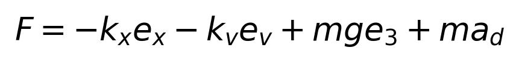

The desired body z-axis is aligned with the force; the desired yaw supplies the remaining heading reference for R_d. Thrust is the projection of that force onto the current body z-axis. Attitude error and angular velocity determine the moment in Equations (2) and (3). The allowed simplification omits desired angular-rate and angular-acceleration feedforward.


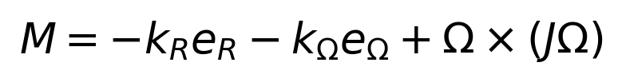

### 2.2 Procedure and Recording

Table 3. Experimental procedure

| Step | Action and purpose | Check |
| --- | --- | --- |
| 1 | Install interfaces/dependencies; compile the workspace | Eight packages succeeded; none failed |
| 2 | Start Unity, bridge, RViz and controller | Both state streams are present |
| 3 | Use STATIC_POSE=1 for hover at (0,0,2) m | Tune until no obvious flipping or growing sway |
| 4 | Use STATIC_POSE=0; rebuild for circle flight | Record video, bag and gains after settling |

## 2.3 Reference Calculations and Gain Selection

The circle is not just a list of isolated position targets. The publisher also supplies velocity and acceleration, allowing the controller to anticipate the motion rather than only reacting to position error. Differentiating the supplied reference gives Table 3a.

Table 3a. Supplied circle reference and its derivatives

| Axis | Position (m) | Velocity (m/s) | Acceleration (m/s squared) |
| --- | --- | --- | --- |
| x | 5sin(t/2) | 2.5cos(t/2) | -1.25sin(t/2) |
| y | 5cos(t/2) | -2.5sin(t/2) | -1.25cos(t/2) |
| z | 2 | 0 | 0 |

The horizontal speed is 2.5 m/s, centripetal acceleration is 1.25 m/s squared, and period is about 12.57 s. With drag neglected, thrust must both support weight and provide the inward force. The corresponding ideal tilt is arctan(1.25/9.81), about 7.26 degrees. This is a reference-based calculation, not a measured flight attitude.

Table 3b. Roles of the four gains

| Gain | Final value | Main role | Practical interpretation |
| --- | --- | --- | --- |
| kx | 2 | Position feedback | Pulls toward the target; aggressive correction may overshoot |
| kv | 3 | Velocity feedback | Damps motion during position correction |
| kr | 3 | Attitude feedback | Turns the body toward the required thrust direction |
| komega | 1 | Angular-rate feedback | Damps fast rotation, including sustained turning |

A scale check is also possible with the source constants. For m=1 and c_f=0.001, equal rotor speeds in ideal level hover are sqrt[mg/(4c_f)], about 49.52 rad/s. This lies within the recorded command range of 29.17-63.60 rad/s. It is only a rough magnitude check, not evidence that the model parameters or allocation matrix are exact.

Frame directions, rotor numbering and units should therefore be checked before blaming the gains. Making commands larger might produce lift temporarily without fixing an incorrect control direction. The tuning sequence and measured results follow in the next section.

## 3 Results

The hover target was 2 m high with a yaw of 45 degrees. Figure D4 gives a height of 1.952798 m; a separate terminal reading was 1.957025 m. These are different snapshots, not a repeated-measurement average or a statistical hover-error estimate.

Table 4. Gain adjustments; the first two stages are debugging observations

| Stage | kx / kv / kr / komega | Observation |
| --- | --- | --- |
| Initial implementation | 6 / 4 / 30 / 10 | Flipping and large command changes |
| Lower attitude gains | 6 / 4 / 3 / 1 | Hover achieved; sway still grew |
| Final gains | 2 / 3 / 3 / 1 | No obvious sway; circle flight recorded |

The reference follows Table 3a with yaw_d=-t/2. Figure D5 records the RViz circle display; Figure 1 plots the bag-derived paths, and Table 5 gives the statistics.


Table 5. Circle-tracking statistics

| Metric | Value |
| --- | --- |
| Common interval / position samples | 933.72-978.36 s; 44.64 s; 2,233 samples |
| Actual revolutions | Approximately 3.552 |
| 3D position RMSE / mean error | 0.1052 m / 0.1049 m |
| Maximum / 95th-percentile error | 0.1166 m / 0.1134 m |
| x / y / z RMSE | 0.0631 / 0.0632 / 0.0556 m |
| Mean height / height range | 1.9446 m / 1.9318-1.9570 m |
| Mean radius / radial RMSE | 5.0466 m / 0.0466 m |
| Yaw RMSE / rotor command range | 9.524 degrees / 29.17-63.60 rad/s |

## 4 Discussion

### 4.1 Error Calculation

Root-mean-square error (RMSE) summarises the run while weighting larger deviations more strongly. The 3D position RMSE is the square root of the mean squared position-error norm. Actual states were sorted and deduplicated by header timestamp. Desired positions were linearly interpolated from bag ROS receipt times to those state times, using only the common interval. Yaw was unwrapped before interpolation and its error wrapped to [-pi,pi] to avoid artificial jumps at 180 degrees.

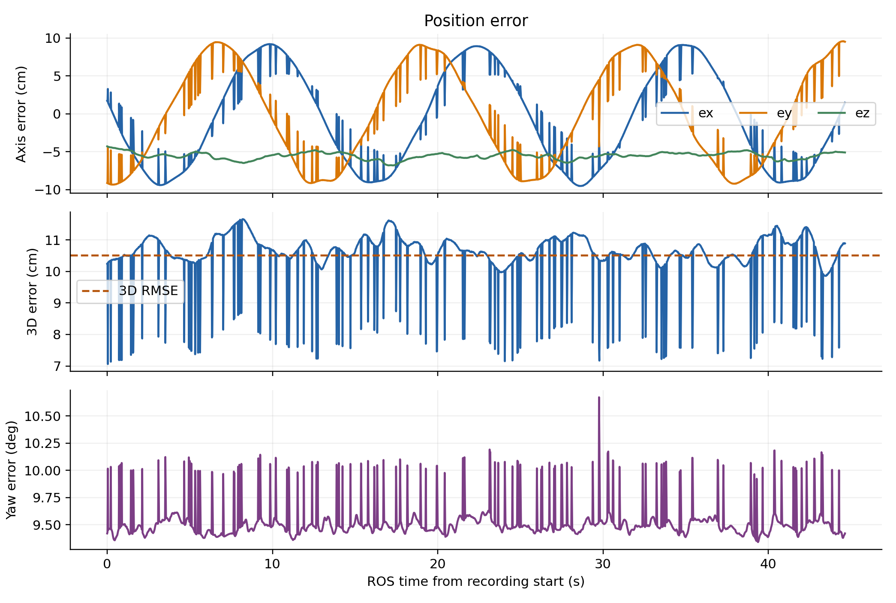

### 4.2 Interpreting Position and Heading Errors

Position errors do not grow continuously in Figure 2, supporting stable tracking during this recording rather than a stability proof for all initial states. Mean height is 5.54 cm below the target and mean radius is 4.66 cm too large. A visually circular path can therefore still contain persistent errors. Radial error describes circle size; it cannot replace 3D error, which also includes phase and height differences.

The heading lag is consistent with the omission of angular-rate feedforward. In an approximate steady pure-yaw motion, angular damping must be balanced by the moment from a nonzero attitude error. With k_R=3, k_omega=1 and desired rate magnitude 0.5 rad/s, the estimated error magnitude is arcsin(1/6), about 9.59 degrees, close to the measured 9.524 degrees. This explains a plausible mechanism rather than identifying every source of error.

The bag contains 2,235 current-state messages, of which 2,233 aligned samples were used; desired states and rotor commands each contain 4,404 messages. Unequal counts alone do not establish packet loss. Every common-time sample was included without error-based rejection. The video lasts 40 s at 15 frames/s; wall-clock video time and bag simulation time were treated separately.

### 4.3 Tuning and Measurement Limitations

The first problem was flipping. After that was reduced, the vehicle could hover but its sway still grew. Setting kr=3 and komega=1 softened the attitude corrections; kx=2 and kv=3 then removed the obvious hover sway. Larger gains were not automatically better: a correction could also overshoot. Table 4 records these debugging steps, rather than a controlled gain comparison. The final values worked in this setup; they were not shown to be optimal.

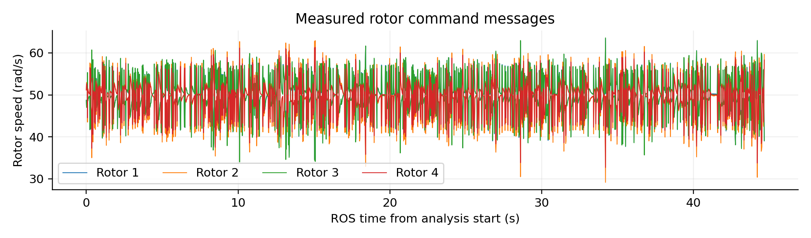

Table 6. Scope and limitations of the results

| Limitation | Effect on interpretation |
| --- | --- |
| One settled circle recording | Take-off, mode-switch transients and repeatability were not evaluated |
| State header time versus desired receipt time | Message latency may affect instantaneous errors; timing uncertainty was not separately estimated |
| No drag compensation or desired-rate feedforward | The observed performance cannot be credited to those changes |
| Constants inherited from the starter code | Mass and inertia were not independently identified in this work |

## 5 Conclusions

After completing and tuning the controller, the vehicle could hover and track a circle. With kx=2, kv=3, kr=3 and komega=1, the 44.64 s run gave a 3D position RMSE of 10.52 cm and a yaw RMSE of 9.524 degrees. Frame directions, rotor numbering and correction strength needed particular care; building successfully was not enough. D2 included the configuration analysis and drag-compensation derivation, but compensation was not added to the flight code. The next step is to repeat matched trials, then test rate feedforward and drag compensation one at a time.

## References

[1] MIT VNAV. Lab 3 Exercises, 2023. https://vnav.mit.edu/labs_2023/lab3/exercises.html
[2] MIT-SPARK. VNAV-labs, VNAV2021 release. https://github.com/MIT-SPARK/VNAV-labs/releases/tag/VNAV2021
[3] Lee T, Leok M, McClamroch N H. Geometric Tracking Control of a Quadrotor UAV on SE(3). IEEE CDC, 2010: 5420-5425.
[4] ROS geometry2, noetic-devel. https://github.com/ros/geometry2/tree/noetic-devel

## Appendix A. D1 Conversions and D2A Rotor Analysis

A quaternion represents attitude with four numbers. ROS fields and the Eigen constructor use different ordering conventions, so conversion interfaces help avoid manual ordering errors. The following conversions assume a valid unit quaternion; otherwise normalisation is needed.

```cpp
tf2::fromMsg(quat_msg, quat_tf);                  // A1
geometry_msgs::Quaternion quat_msg = tf2::toMsg(quat_tf); // A2
quat_tf.w();                                     // A3
tf2::getYaw(quat_t);                              // B1
Eigen::Quaterniond quat_e;                        // B2
tf2::fromMsg(quat_msg, quat_e);
Eigen::Matrix3d R = quat_e.toRotationMatrix();
```

Include the headers for tf2_geometry_msgs, tf2/LinearMath/Quaternion.h, tf2/utils.h, tf2_eigen and Eigen/Geometry. The Eigen quaternion constructor takes (w,x,y,z); ROS messages expose the fields x, y, z and w.

Question A asks whether changing propellers 3 and 4 and reversing their rotation still allows independent position and heading control. Use the exercise numbering: in top view, x points right and y upward. Rotor positions are (-a,a), (-a,-a), (a,-a), (a,a), with a=d/sqrt(2). For u_i=omega_i squared, [f,tau_x,tau_y,tau_z]^T=Fu. This numbering is separate from the simulator numbering.

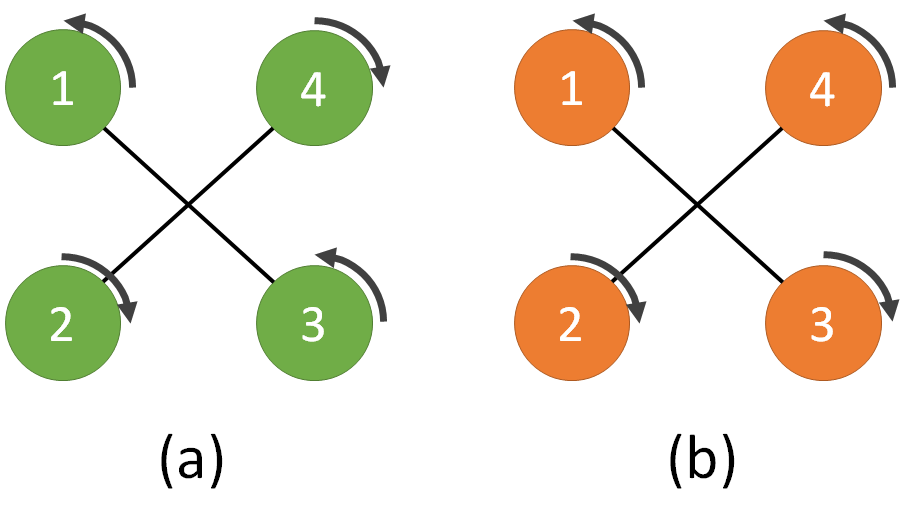

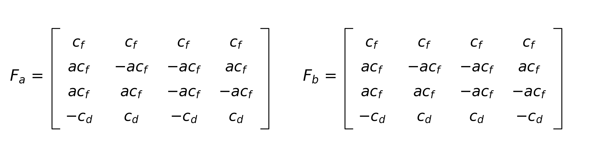

Table A1. Configuration analysis for positive coefficients

| Configuration | Result | Meaning |
| --- | --- | --- |
| a | rank=4; |det|=16a^2c_f^3c_d | Four independent control components |
| b | rank=3; tau_z=-c_d tau_x/(a c_f) | Roll and yaw are coupled, not independently assignable |

For positive a, c_f and c_d, the normal matrix has a nonzero determinant and rank 4. In configuration b, the first three rows are independent, but row 4 equals row 2 multiplied by -c_d/(a c_f), giving rank 3. Changing roll moment therefore forces a linked change in yaw moment. Position and yaw cannot be assigned independently in general. Special motions that satisfy this constraint may still be possible.

## Appendix B. D2B Drag Model and Compensation

Question B asks how the given drag model could improve tracking. Estimate the drag first, then ask the rotors for an opposing force. R maps body vectors to the world frame, so compute body velocity as v_b=R^T v before using the model.

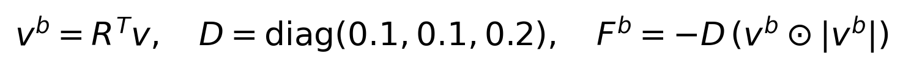

D=diag(0.1,0.1,0.2). The product is component by component. Drag opposes the velocity and grows with its squared magnitude along each axis. With world z pointing upward, the force balance is:

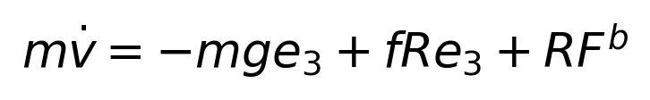

Set e_x=x-x_d and e_v=v-v_d. Transform the estimated drag to the world frame and subtract it from the baseline force. Subtracting the external force requests a force in the opposite direction:


Construct the desired attitude from the compensated force and project it onto the current thrust axis:


If attitude tracking makes the thrust vector close to A, substitution into the force balance gives Equation (B5). A good estimate cancels most of the disturbance. Model error and noisy velocity leave a residual, so a flight comparison is still needed to establish any improvement.

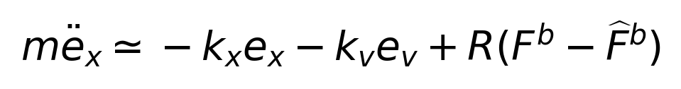

Table B1. Derivation and proposed validation

| Item | Scope in this work |
| --- | --- |
| Work completed | Derivation only; not added to the flight code or tested in a flight comparison |
| How to check it | Keep the path, gains and initial state fixed; compare errors and commands with compensation on and off |

## Appendix C. Completed Core Code

The 11 completed solution blocks are grouped by the original PART 1 to PART 5: declarations, initialisation, two desired-state blocks, one current-state block, and six control/output blocks. The excerpts preserve the algorithm and add comments; class scaffolding and repeated starter comments are omitted. They are not standalone compilable files. The full source accompanies the report.

### C.1 Communication and Desired-State Reading

```cpp
// PART 1: communication handles and startup state flags.
ros::Subscriber desired_sub, current_sub;
ros::Publisher rotor_pub;
ros::Timer control_timer;
bool have_desired = false, have_current = false;

// PART 2: bind state callbacks; keep the latest queued message.
desired_sub = nh.subscribe("desired_state", 1,
                          &controllerNode::onDesiredState, this);
current_sub = nh.subscribe("current_state", 1,
                          &controllerNode::onCurrentState, this);
rotor_pub = nh.advertise<mav_msgs::Actuators>("rotor_speed_cmds", 1);
control_timer = nh.createTimer(ros::Duration(1.0 / hz),
                              &controllerNode::controlLoop, this);

// PART 3: inside onDesiredState(). Check arrays before indexing.
if (des_state.transforms.empty() || des_state.velocities.empty() ||
    des_state.accelerations.empty()) return;
const auto& position = des_state.transforms[0].translation;
const auto& velocity = des_state.velocities[0].linear;
const auto& acceleration = des_state.accelerations[0].linear;
xd << position.x, position.y, position.z;
vd << velocity.x, velocity.y, velocity.z;
ad << acceleration.x, acceleration.y, acceleration.z;

// Reject a zero/invalid quaternion, then normalise before yaw extraction.
const auto& q = des_state.transforms[0].rotation;
const double norm2 = q.x*q.x + q.y*q.y + q.z*q.z + q.w*q.w;
if (!std::isfinite(norm2) || norm2 < 1e-12) return;
tf2::Quaternion quat(q.x, q.y, q.z, q.w);
quat.normalize();
yawd = tf2::getYaw(quat);
have_desired = xd.allFinite() && vd.allFinite() && ad.allFinite()
               && std::isfinite(yawd);
```

Table C1. Communication and input checks

| Block | Explanation |
| --- | --- |
| Subscriber / Publisher / Timer | Receive states, send commands and schedule control; queue size 1 retains the latest queued message. |
| Empty-array checks | Check before accessing [0], avoiding out-of-range reads. |
| Quaternion normalisation | Reject invalid or near-zero inputs before extracting yaw. |
| have_desired | Allows startup after finite values are received; this is not a complete stale-message watchdog. |

## C.2 Current State and Desired Attitude

```cpp
// PART 4: inside onCurrentState(). Read position and velocity.
const auto& position = cur_state.pose.pose.position;
const auto& velocity = cur_state.twist.twist.linear;
const auto& q = cur_state.pose.pose.orientation;
Eigen::Quaterniond quat(q.w, q.x, q.y, q.z); // Eigen order: w,x,y,z.
if (!std::isfinite(quat.squaredNorm()) || quat.norm() < 1e-6) return;
quat.normalize();
R = quat.toRotationMatrix();
x << position.x, position.y, position.z;
v << velocity.x, velocity.y, velocity.z;
const auto& rate = cur_state.twist.twist.angular;
// This bridge gives WORLD angular rate; the moment law needs BODY rate.
omega = R.transpose() * Eigen::Vector3d(rate.x, rate.y, rate.z);
have_current = x.allFinite() && v.allFinite() && R.allFinite()
               && omega.allFinite();

// PARTS 5.1-5.2: inside controlLoop(). Wait for valid initial states.
if (!have_current || !have_desired) {
  ROS_WARN_THROTTLE(2.0, "Waiting for valid current and desired states.");
  return;
}
ex = x - xd;  // Actual minus desired: feedback below uses a minus sign.
ev = v - vd;
// World z is UP; compensate gravity with +m*g*e3.
const Eigen::Vector3d force = -kx*ex - kv*ev + m*g*e3 + m*ad;
if (!force.allFinite() || force.norm() < 1e-6) return;
const Eigen::Vector3d b3d = force.normalized();
const Eigen::Vector3d heading(std::cos(yawd), std::sin(yawd), 0.0);
Eigen::Vector3d b2d = b3d.cross(heading);
if (b2d.norm() < 1e-6) return; // Avoid normalising a degenerate axis.
b2d.normalize();
const Eigen::Vector3d b1d = b2d.cross(b3d);
Eigen::Matrix3d Rd;
Rd.col(0) = b1d;
Rd.col(1) = b2d;
Rd.col(2) = b3d;
```

Table C2. Frame and sign checks

| Key statement | Explanation |
| --- | --- |
| R.transpose() * rate | R maps body to world; R transpose maps back. This follows this lab bridge angular-rate convention. |
| -kx*ex - kv*ev | Errors are actual minus desired; negative feedback acts to reduce them. |
| +m*g*e3 + m*ad | Compensates gravity and anticipates the required reference acceleration. |
| Normalisation and cross products | Force sets body z; yaw sets heading; cross products complete the orthogonal frame. |

These checks prevent some invalid inputs and degenerate calculations, but the code does not implement a complete fault-handling system, such as stale-state timeout handling. Startup checks should not be described as a guarantee of safety under all faults.

## C.3 Moments, Rotor Allocation and Publication

```cpp
// Constructor: build the allocation map ONCE using simulator numbering.
const double arm = d / std::sqrt(2.0); // X layout, not a full arm on x/y.
Eigen::Matrix4d allocation;
allocation << cf, cf, cf, cf,
              arm*cf, arm*cf, -arm*cf, -arm*cf,
              -arm*cf, arm*cf, arm*cf, -arm*cf,
              cd, -cd, cd, -cd;
F2W = allocation.inverse();

// PARTS 5.3-5.4: attitude error, thrust and moment in controlLoop().
er = 0.5 * Vee(Rd.transpose()*R - R.transpose()*Rd);
eomega = omega; // Lab simplification: no desired-rate feedforward.
const double thrust = force.dot(R.col(2));
const Eigen::Vector3d moment = -kr*er - komega*eomega
                               + omega.cross(J*omega);
Eigen::Vector4d wrench;
wrench << thrust, moment.x(), moment.y(), moment.z();

// PART 5.5: solve u_i = omega_i * abs(omega_i), preserving its sign.
const Eigen::Vector4d rotor_signed_square = F2W * wrench;
if (!rotor_signed_square.allFinite()) {
  ROS_ERROR_THROTTLE(1.0, "Non-finite rotor command: stop and inspect states.");
  return;
}

// PART 5.6: publish four rotor speeds, not their squared values.
mav_msgs::Actuators command;
command.header.stamp = ros::Time::now();
command.angular_velocities.resize(4);
for (int i = 0; i < 4; ++i) {
  command.angular_velocities[i] = signed_sqrt(rotor_signed_square(i));
}
rotor_pub.publish(command);
```

Table C3. Allocation checks

| Key point | Explanation |
| --- | --- |
| Rotor positions and signs | Simulation numbering: 1(+x,+y), 2(-x,+y), 3(-x,-y), 4(+x,-y); yaw signs +,-,+,-. |
| Vee and moment law | Vee converts a skew matrix to a vector; attitude feedback corrects orientation and rate feedback damps rotation. |
| signed_sqrt | Preserves the sign of u when taking its square root, following this simulator convention. |
| Output length and units | Publish four angular velocities in rad/s, not rpm or squared speeds. |

The starter constants are retained: m=1, d=0.3, c_f=0.001, c_d=0.00001 and J=I. For J=I, omega cross (J omega) vanishes, but the term is retained to match the general rotational equation. Inline comments and Tables C1-C3 explain the role of each block.

## Appendix D. Original Experimental Screenshots

Five originals are selected: environment, simulator scene, completed-code build, hover height and circle display. The initial build and similar static RViz views are omitted here. All eight original screenshots remain in the materials folder.

Repository: https://github.com/hbyhby123/vnav-personal
Screenshot directory: lab3/data/raw/screenshots; checked revision: 9ea7853.

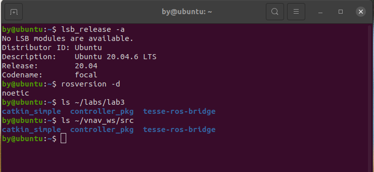


Figure D1 verifies the environment and paths. Figure D2 confirms simulator startup, not correct controller operation. Flight performance is assessed with the later state displays, video and bag data.

## D.1 Build and Flight Evidence

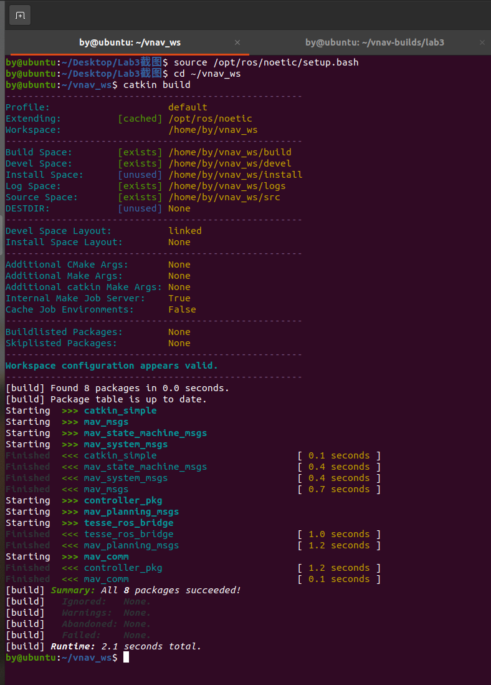

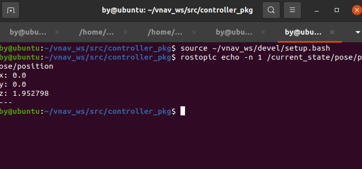

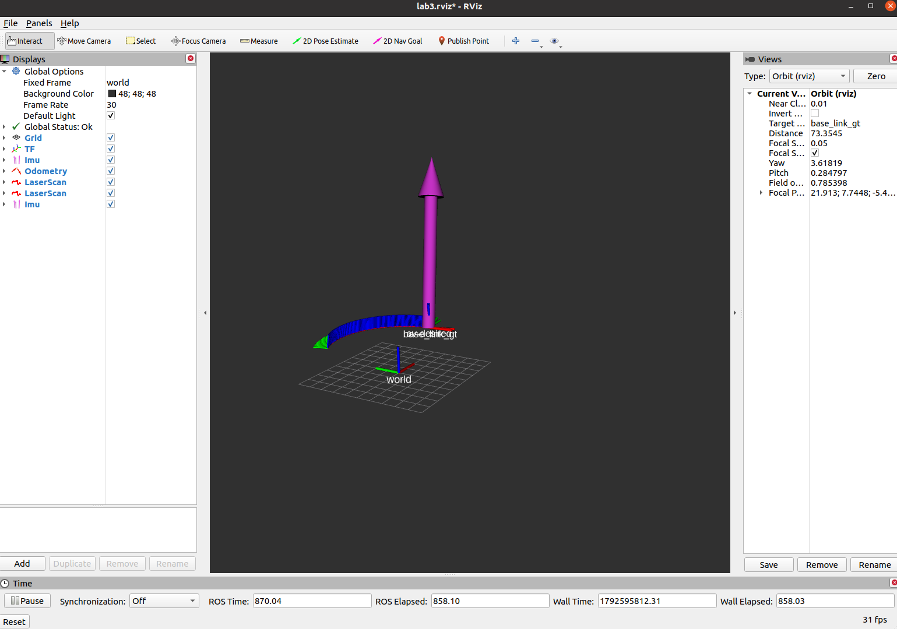

Figure D3 checks the build; Figure D4 records a single height. The video checks continuous circling, while the bag supports run-wide error calculations. These sources answer different questions.
