# Lab 3 无人机轨迹生成与跟踪控制实验报告

姓名：黄博宇；学号：24020036026；班级：中外计科一班；组号：8。

姓名 黄博宇    学号 24020036026
班级 中外计科一班    组号 8    实验日期 2026年10月21日

### 实验概述

本实验在ROS Noetic与TESSE仿真环境中完成四旋翼几何控制器。轨迹发布器提供目标位置、速度、加速度和yaw；控制器根据当前状态计算总推力与力矩，并转换为四个旋翼转速。先完成定点悬停，再跟踪半径5米、高度2米的圆轨迹。

实测录制段包含2233个对齐位置样本，覆盖44.64秒和约3.55圈。三维位置RMSE为0.1052米，最大误差0.1166米，平均飞行高度1.9446米。轨迹连续稳定，但保留约9.52度的偏航RMSE，说明简化控制器仍有改进空间。

### 实验环境与任务

| 项目 | 配置 |
|---|---|
| 操作系统 | Ubuntu 20.04.6 LTS，VMware虚拟机 |
| 中间件与工具 | ROS Noetic，catkin_tools，RViz |
| 源码版本 | MIT-SPARK/VNAV-labs，标签VNAV2021 |
| 仿真器 | 课程提供lab3.zip中的TESSE Unity程序 |
| 记录与分析 | ROSbag；Python离线时间对齐及指标计算 |


任务包括D1旋转表示转换、D2四旋翼结构与阻力补偿推导、D3控制器实现和圆轨迹演示。

## 旋转表示转换与状态接口

Deliverable 1  以下代码针对ROS 1 Noetic；完整答案另存deliverable_1.txt。

### A1 消息四元数转为已有tf2四元数

```cpp
tf2::fromMsg(quat_msg, quat_tf);
```

### A2 tf2四元数转为新消息变量

```cpp
geometry_msgs::Quaternion quat_msg = tf2::toMsg(quat_tf);
```

### A3 读取四元数标量分量

```cpp
quat_tf.w();
```

### B1 一次函数调用提取yaw

```cpp
tf2::getYaw(quat_t);
```

### B2 消息四元数转Eigen旋转矩阵

```cpp
Eigen::Quaterniond quat_e;
tf2::fromMsg(quat_msg, quat_e);
Eigen::Matrix3d R = quat_e.toRotationMatrix();
```

两次转换调用为fromMsg和toRotationMatrix，假设输入为有效单位四元数；非单位输入需额外归一化。Eigen四元数构造器顺序为(w,x,y,z)，而ROS按字段命名为x,y,z,w，使用转换接口可避免手写顺序混淆。

所需头文件：tf2_geometry_msgs/tf2_geometry_msgs.h、tf2/LinearMath/Quaternion.h、tf2/utils.h、tf2_eigen/tf2_eigen.h及Eigen/Geometry。

### 控制器使用的消息接口

| 话题 | 消息类型与用途 |
|---|---|
| /desired_state | MultiDOFJointTrajectoryPoint；读取目标位置、速度、加速度、yaw |
| /current_state | nav_msgs/Odometry；读取实际位置、姿态、速度和角速度 |
| /rotor_speed_cmds | mav_msgs/Actuators；发送4个旋翼角速度，单位rad/s |

## 四旋翼结构与控制分配

Deliverable 2A

为避免题图与仿真器的旋翼编号混淆，本题单独定义：顶视图中x向右、y向上、z向外；1号在左上、2号在左下、3号在右下、4号在右上。四个旋翼位置分别为(-a,a)、(-a,-a)、(a,-a)、(a,a)，a=d/√2。


令u_i=ω_i²（讨论正向工作点），每个旋翼升力为c_f u_i，总控制量为[f,τ_x,τ_y,τ_z]^T。升力沿+z，故τ_x=y_i c_f u_i、τ_y=-x_i c_f u_i。以反作用偏航力矩为准，a配置的符号为[-,+,-,+]；b配置为[-,+,+,-]。


假设a、c_f、c_d均为正。F_a的四行相互独立，其行列式绝对值为16a²c_f³c_d，因此rank(F_a)=4。F_b的前三行相互独立，而第四行等于第二行的-c_d/(a c_f)倍，因此rank(F_b)=3。

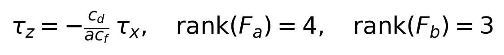

配置b的滚转力矩与偏航力矩被固定关系耦合，无法独立指定总推力和三轴力矩。一般位置轨迹要求通过滚转、俯仰来改变推力方向，同时还需独立调节yaw；rank=3使这些要求一般无法同时满足。结论是不能任意独立跟踪[x,y,z]与yaw，并不排除某些特殊可行运动。

说明：若采用相反的偏航正方向，矩阵最后一行整体变号，但秩和不可独立控制的结论不变。

## 速度相关阻力与补偿

Deliverable 2B

令R把机体系向量变换到世界系，v为世界系速度，v_b为机体系速度。题设阻力始终与各机体系速度分量反向，用逐元素运算写为：


其中⊙表示逐元素相乘，|v_b|表示逐元素绝对值。这等价于题面给定的[-v_x_b|v_x_b|,-v_y_b|v_y_b|,-v_z_b|v_z_b|]^T乘以对角系数矩阵。

在ROS的z向上约定下，带阻力的平移动力学是：


用当前测量速度估计机体系阻力，再将估计值转到世界系。若位置、速度误差分别为e_x=x-x_d、e_v=v-v_d，期望合力应取：

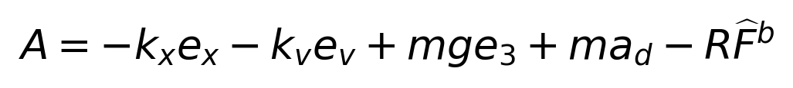

从期望合力构造期望机身z轴，并投影到当前推力轴计算总推力：

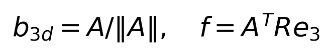

将控制器实际产生的推力向量近似为A代回动力学，得到m d²e_x/dt²≈-k_x e_x-k_v e_v+R乘以实际与估计机体系阻力之差。估计准确时，阻力项被抵消，控制器无需单靠跟踪偏差来产生对抗阻力的力，从而有望减小高速轨迹的系统误差。

### 实现时的注意事项

先计算v_b=R^Tv，再在机体系应用各向异性系数；不能直接把世界系速度代入机体系阻力模型。因为阻力与速度反向，控制合力中应减去估计的外力；简单重复加阻力会使误差更大。速度噪声、模型偏差和转子可实现范围会限制补偿效果。

### 本次实现的范围

以上是题目要求的补偿推导。本次团队飞行代码采用基础几何控制，没有加入该阻力补偿，也没有实施有无补偿的对比实验，因此不把实际结果中的误差下降归因于阻力补偿。

## 几何控制器实现

controller_node.cpp共补齐11处空白，保留原始教学代码结构。ROS订阅器接收目标和实际状态，定时器触发控制计算，发布器输出四个旋翼的有符号角速度。只有收到有效、有限且非空的两类状态后才开始计算。

### 误差与期望姿态

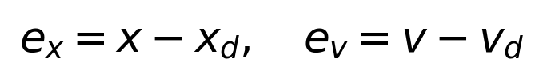


采用ROS的世界系与机体系z轴向上约定，令b3d=F/‖F‖。通过期望yaw建立水平参考轴，再用归一化叉积构造b2d和b1d，组合R_d=[b1d,b2d,b3d]。总推力f为F沿当前机身z轴的投影。

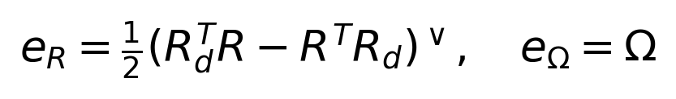


按题面允许的简化，省略期望角速度和角加速度前馈，e_Ω取当前机体系角速度。该实验桥接的角速度消息按世界系处理，因此先乘R^T转换到机体系。

### 从力和力矩分配旋翼转速

仿真器旋翼编号与D2题图不同：1在(+x,+y)，2在(-x,+y)，3在(-x,-y)，4在(+x,-y)，偏航力矩符号为[+,-,+,-]。按这些位置和转向建立可逆分配矩阵B。

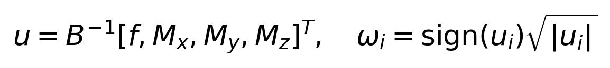

其中u_i=ω_i|ω_i|。仿真器支持有符号转速，负值不应一律截为0。质量m=1、臂长d=0.3、c_f=0.001、c_d=0.00001及J=I沿用实验源码；这些源码常量不等同于独立标定的真实物理参数。

| 文件 | 主要作用 |
|---|---|
| src/controller_node.cpp | 读取状态、计算误差与控制量、分配并发布转速 |
| src/traj_publisher.cpp | STATIC_POSE=1悬停；0为圆轨迹 |
| launch/traj_tracking.launch | 启动两个节点，并设置kx、kv、kr、komega |

## 实验步骤与悬停验证

准备源码、TESSE Python接口、mav_comm和catkin_simple后编译工作空间；依次打开Unity、ROS桥接和RViz，再启动控制器。编译结果显示8个包成功，CMake策略提示未导致构建失败。

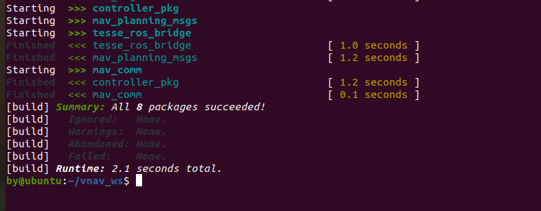

### 先定点悬停

设置STATIC_POSE=1，目标位置为(0,0,2)米，目标yaw为45度。初期高增益导致明显翻转；降低姿态增益后能够悬停，但仍晃动；进一步减小平移增益后，观察到悬停不再明显晃动。


另一次命令行读数为z=1.957025米。两次均接近2米目标，但单次读数不能作为全程RMSE或稳定性统计。

| 阶段 | kx / kv / kr / komega | 实际观察 |
|---|---|---|
| 初次实现 | 6 / 4 / 30 / 10 | 翻转乱飞，旋翼命令剧烈反向 |
| 降低姿态反馈 | 6 / 4 / 3 / 1 | 能够悬停，但晃动逐渐明显 |
| 最终采用 | 2 / 3 / 3 / 1 | 悬停不再明显晃动；随后完成圆轨迹录制 |

表中前两组主要依据故障bag与调试观察，不将未录制的中间阶段写成定量对照实验。

## 圆轨迹与实测结果

设置STATIC_POSE=0并重新编译。原始轨迹为x_d=5sin(t/2)、y_d=5cos(t/2)、z_d=2，yaw_d=-t/2；周期4π≈12.57秒，水平速度2.5米每秒。采用参数2、3、3、1，待轨迹稳定后录制。

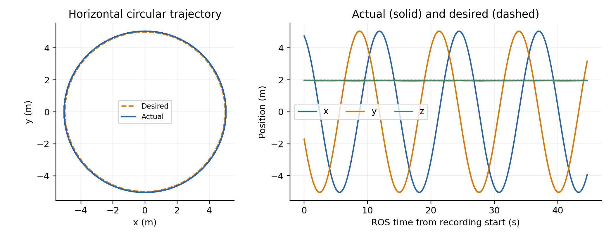

| 指标 | 实测值 |
|---|---|
| 对齐时间范围 | ROS时间933.72—978.36秒，共44.64秒 |
| 位置样本与绕行圈数 | 2233点，实际约3.552圈 |
| 三维位置RMSE / 平均误差 | 0.1052米 / 0.1049米 |
| 最大 / 95分位三维误差 | 0.1166米 / 0.1134米 |
| x / y / z分量RMSE | 0.0631 / 0.0632 / 0.0556米 |
| 平均高度与范围 | 1.9446米；1.9318—1.9570米 |
| 平均半径 / 径向RMSE | 5.0466米 / 0.0466米 |
| 偏航RMSE | 9.524度 |
| 旋翼指令范围 | 29.17—63.60 rad/s |

### 指标计算方法

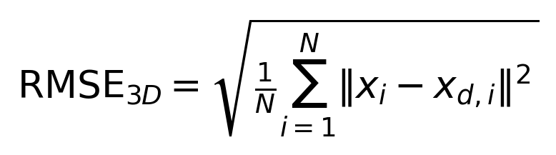

按实际状态header时间戳排序去重，将期望状态按bag记录的ROS时间线性插值到实际状态时刻，只取共同时间范围；使用录制段全部对齐样本，没有按误差大小删点。偏航先解包连续角再插值，差值折回[-π,π]。

bag中含/current_state 2235条、/desired_state和/rotor_speed_cmds各4404条、/clock 2203条。视频为15帧每秒、600帧，共40秒。视频现实时间与ROS仿真时间分开使用。

## 误差变化与控制局限


位置误差总体有界，没有在这段录制中呈持续发散趋势。平均高度比目标低约5.54厘米，平均半径比目标大约4.66厘米。图中保留原始采样造成的局部尖峰，没有对数据做平滑以隐藏误差。时间戳与消息到达关系也会影响这些短时变化。

偏航存在接近常值的滞后。由于本次按允许简化令e_Ω=Ω，期望yaw以-0.5 rad/s持续变化时，角速度阻尼需要由非零姿态误差产生的力矩来平衡。近似纯yaw稳态关系给出约9.59度，与实测9.52度量级一致；这是一种机制解释，不是全部误差的严格辨识。

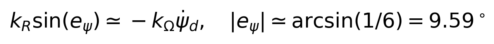

进一步改进可以补入期望角速度前馈、加入经过验证的外力补偿，或在检查转子限制与采样延迟后继续调参。此次未实施这些改进，不能据此声称已经消除了稳态偏差。

## 检查复现与结论

每个代码框使用一个独立终端，启动后保持运行。已配置好的工作空间无需重新安装依赖。

### 启动顺序

```cpp
cd ~/vnav-builds/lab3
./lab3.x86_64
```

```cpp
source /opt/ros/noetic/setup.bash
source ~/vnav_ws/devel/setup.bash
roslaunch tesse_ros_bridge tesse_quadrotor_bridge.launch
```

```cpp
source /opt/ros/noetic/setup.bash
source ~/vnav_ws/devel/setup.bash
roscd controller_pkg
rviz -d rviz/lab3.rviz
```

```cpp
source /opt/ros/noetic/setup.bash
source ~/vnav_ws/devel/setup.bash
roslaunch controller_pkg traj_tracking.launch kx:=2 kv:=3 kr:=3 komega:=1
```

切换悬停与绕圆时，先停控制器，再改STATIC_POSE并catkin build；点击Unity按R重置后启动。最终提交版保持STATIC_POSE=0，并把launch及源码回退默认值统一为2、3、3、1。原始上传包单独保留，控制算法未因整理而改变。

### 实验结论

完成ROS旋转表示转换、控制分配秩分析和阻力补偿推导，补全了四旋翼几何控制器，并通过实测参数调整实现定点悬停和连续圆轨迹跟踪。44.64秒录制段的三维位置RMSE为10.52厘米，偏航仍存在约9.52度RMSE。实验说明坐标系、转子编号和增益需要与实际仿真响应匹配，仅有编译成功不能证明控制稳定。

### 参考资料

[1] MIT VNAV Lab 3 Exercises 2023，题面及仿真器约定。
https://vnav.mit.edu/labs_2023/lab3/exercises.html
[2] MIT-SPARK/VNAV-labs，VNAV2021源码。
https://github.com/MIT-SPARK/VNAV-labs/releases/tag/VNAV2021
[3] Lee T, Leok M, McClamroch N H. Geometric Tracking Control of a Quadrotor UAV on SE(3). IEEE CDC, 2010, 5420—5425.
[4] ROS geometry2 noetic-devel，tf2_geometry_msgs、tf2_eigen与tf2/utils.h源码。
https://github.com/ros/geometry2/tree/noetic-devel

## 实验画面与材料索引

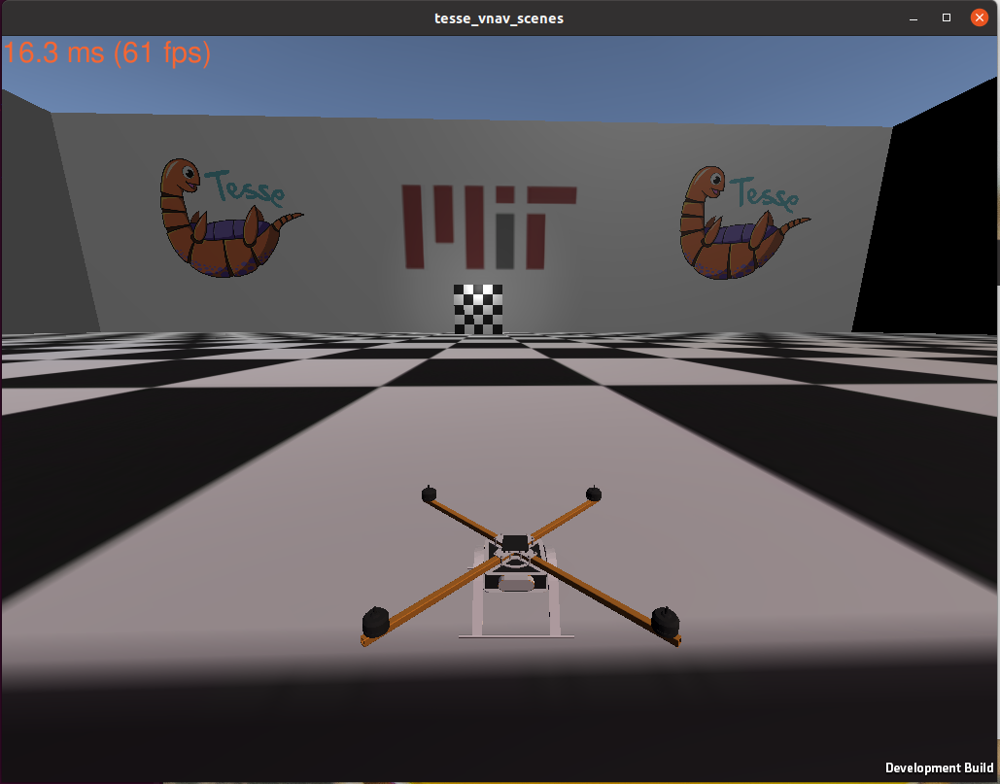

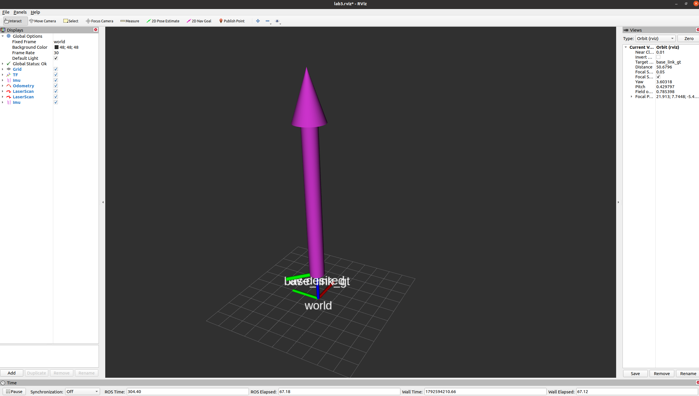


其余原始截图及完整控制器包随提交材料提供。逐样本对齐结果见analysis/aligned_trajectory.csv，指标见analysis/metrics.json。
