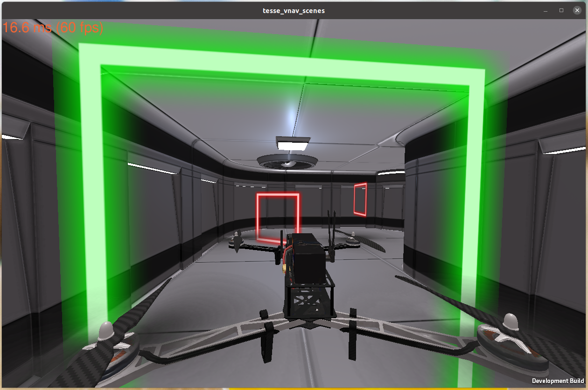
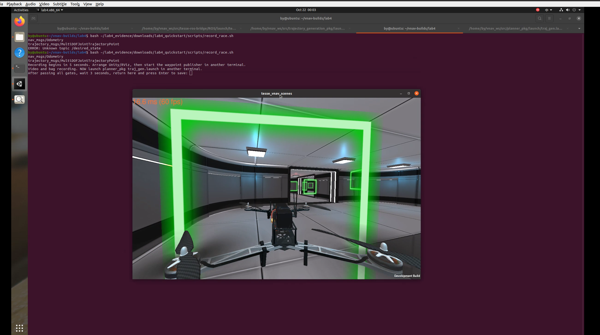
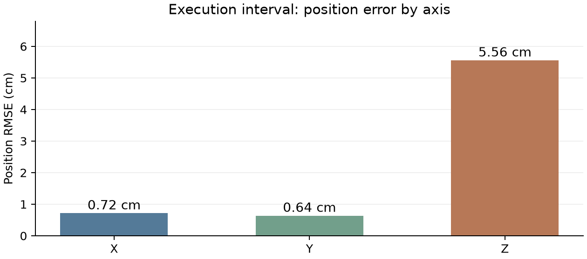
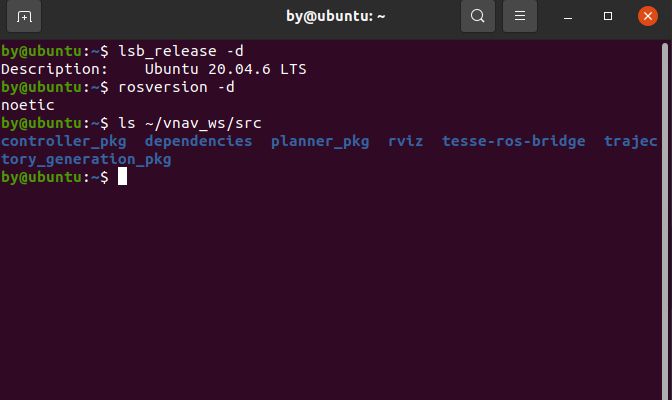
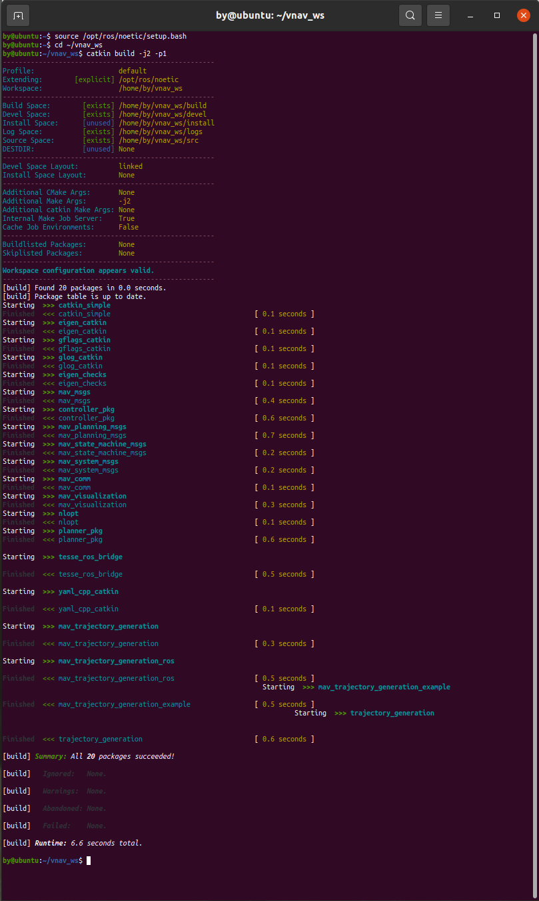
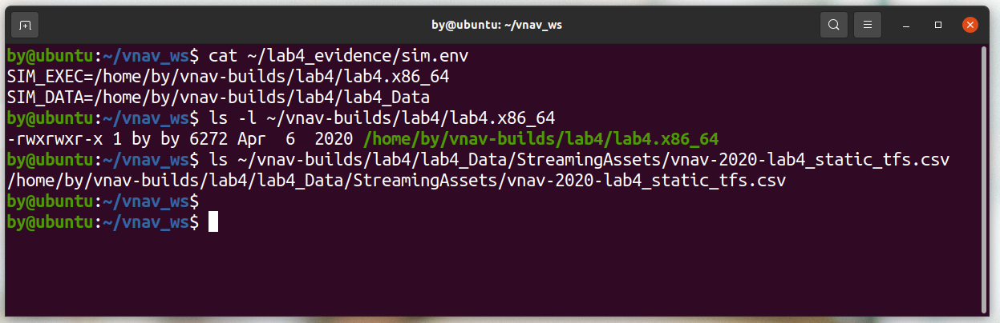
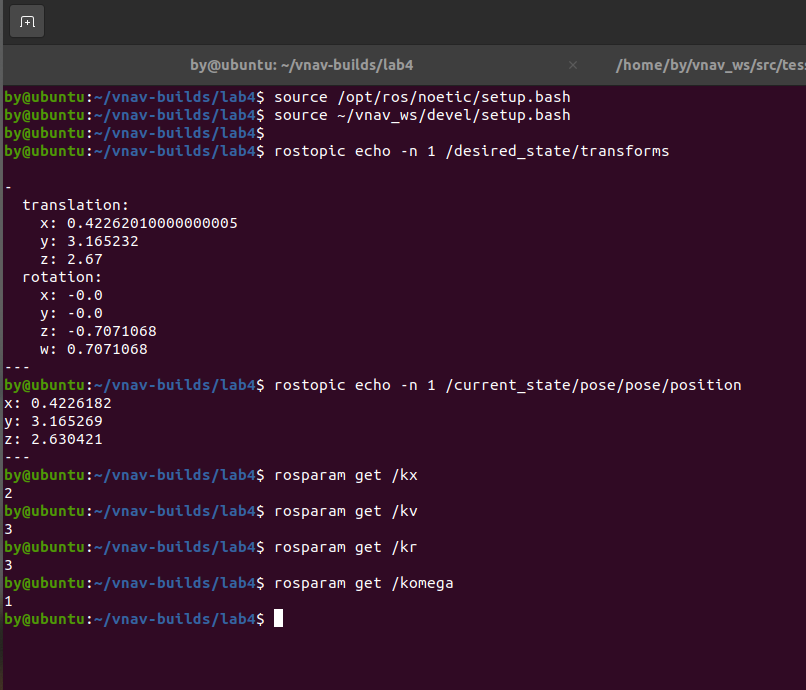
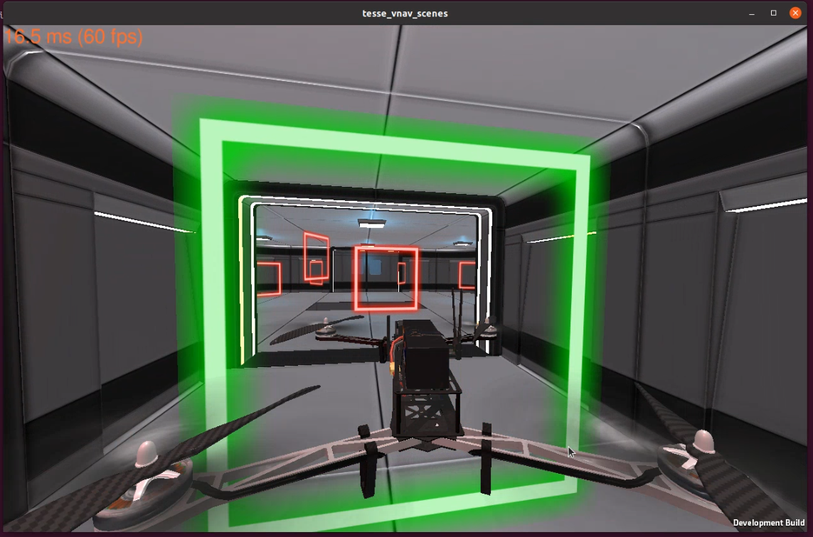
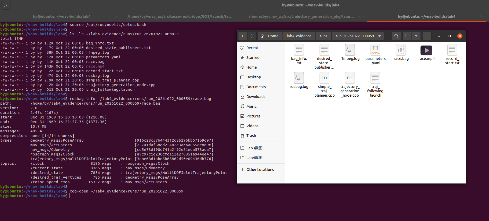

# VNAV Lab4: UAV Control and Racing

Boyu Huang, 24020036026; Class: International Computer Science, Class 1; Group 8

Recorded experiment: 22 October 2026; Report revision: 23 October 2026

## Summary

This experiment connected the Lab3 UAV controller to the Lab4 trajectory generator and tested first-gate hovering followed by one complete course run. Starting from the current vehicle state, the program planned position and yaw trajectories through 12 gate targets and published the reference state at 50Hz. The system ran on Ubuntu 20.04.6 with ROS Noetic and the TESSE Unity simulator. After time alignment of the recorded messages, the three-dimensional position root mean square error during trajectory execution was 0.056426m, with a maximum of 0.084428m. Horizontal tracking was more accurate than vertical tracking. The vehicle was, on average, 0.054671m below the reference, making vertical offset the main error feature. The recorded run supports the operation of the combined planning and control pipeline. The cause of the height offset and the effect of more aggressive timing remain untested.

## 1 Introduction

The task was to move beyond holding a single position and make the UAV follow a sequence of gates. A hovering target is fixed. A racing reference must specify where the vehicle should be, how fast it should move, and where it should point at each instant. Abruptly switching between gate positions would make the reference harder for the controller to follow.

Lab4 provides the time-dependent route, while the Lab3 controller follows it. The planner connects discrete gate targets with smooth trajectories. The controller compares the reference with the measured state and adjusts rotor commands. This repeated correction using feedback is closed-loop control. The experiment first checked the basic system at the first gate, then ran the complete trajectory and examined the saved video and messages. [1,2]

The objectives were to implement Part0 and Parts1.1-1.3, relate the implementation to single- and multi-segment trajectory optimization, and retain evidence that could be checked later. Reliable completion was the priority. No repeated timing sweep was performed, so no fastest-run claim is made.

## 2 Experimental Set-up

The environment, program interfaces, and parameters below describe the configuration used for the recorded run.

Table 1. Environment and operating parameters

| **Item** | **Setting** | **Purpose** |
| --- | --- | --- |
| Operating system and ROS | Ubuntu 20.04.6; ROS Noetic | Run and connect the programs |
| Simulation and code | TESSE Unity Lab4; VNAV2021 | Supply the vehicle, course, and starter code |
| Controller gains | kx=2; kv=3; kr=3; komega=1 | Position, velocity, attitude, and angular-rate feedback |
| Time multiplier | time_scale=2.0 | Double the estimated segment durations |
| Reference update rate | 50Hz | Update approximately every 0.02s |
| Timing estimates | v_max=8.0; a_max=4.0 | Estimate segment times; not enforced flight limits |
| Position and yaw dimensions | 3 and 1 | Plan XYZ and heading separately |
| Polynomial coefficients | N=10 | At most degree nine per segment |

ROS is the framework used to exchange messages between programs. A program is called a node, and a named message channel is a topic. The bridge publishes the simulated state on /current_state. The gate publisher supplies target poses. The trajectory node combines those targets with the current vehicle state and publishes /desired_state. The controller then sends /rotor_speed_cmds back to the simulator.

### 2.1 Trajectory and controller implementation

The completed code is organized into four parts. The main files are simple_traj_planner.cpp and trajectory_generation_node.cpp.

Table 2. Implementation and design choices

| **Part** | **Implementation** | **Reason** |
| --- | --- | --- |
| Part0 | Use the first gate as a fixed target with zero desired velocity and acceleration | Check coordinates and basic control before moving flight |
| Part1.1 | Read current position and yaw; check that the values are valid | Avoid planning from an uninitialized state |
| Part1.2 | Add start and gate constraints; optimize position and yaw separately | Reach targets while coordinating heading |
| Part1.3 | Sample by elapsed time and publish the reference state | Convert a complete trajectory into a current control target |

Yaw is the horizontal heading angle. Its numerical value wraps at plus or minus 180 degrees. A change from 179 to -179 degrees requires only a 2-degree rotation. The implementation uses atan2(sin delta_psi, cos delta_psi) to select the short change between consecutive headings and accumulates these changes into a continuous sequence. This prevents an unnecessary near-full turn.

Position has three components, whereas yaw has one. The optimizations are separate but use the same segment times, so the position and heading references reach each gate at the same planned instant. The initial position and yaw come from the current state. Start and end conditions use makeStartOrEnd; intermediate gates constrain position and yaw. Roll and pitch are handled by the controller rather than prescribed as separate route trajectories.

Minimum snap minimizes the integral of the squared fourth derivative of position. In practical terms, it discourages abrupt changes in the reference motion. The program estimates segment durations, multiplies them by the time scale, and solves for polynomial coefficients with a linear optimizer. It does not directly minimize rotor energy and does not perform online obstacle replanning. [3]

At each update, sampling time is the current ROS time minus the trajectory start time, clamped between zero and the total duration. Pose is placed in transforms, linear velocity in velocities, and linear acceleration in accelerations. Yaw is converted into a quaternion, a four-number representation of three-dimensional orientation. The final reference is held after the trajectory ends. The inherited Lab3 simplification omits desired angular-rate feedforward, meaning no additional advance compensation for reference turning rate was used.

### 2.2 Procedure

Basic control was checked before the complete recorded run.

Table 3. Procedure and checks

| **Step** | **Action and purpose** | **Outcome** |
| --- | --- | --- |
| 1 Prepare the workspace | Resolve dependencies and build | All 20 packages compiled |
| 2 Test the first gate | Start the simulator, bridge, and fixed target | Stable holding near the first gate |
| 3 Change mode | Stop the fixed target, reset, and restart the follower | Avoid competing reference publishers |
| 4 Record the run | Start the follower and recorder before publishing gates | Save continuous video and a bag file |
| 5 Check evidence | Replay the video and inspect state topics | Playable video and both required state streams |

Resetting Unity alone does not clear the trajectory stored in the follower. A repeat run therefore also requires restarting that node. Repeated gate messages do not regenerate an existing trajectory; this prevents normal flight from being repeatedly restarted.



### 2.3 Recording and data processing

The analyzed recording is run_20261022_000059. A bag file stores ROS messages with their recording times. This file contains 40,534 messages, including 8,365 actual-state messages and 7,836 desired-state messages. It also retains the simulation clock, gate targets, and rotor commands.

The two state streams contain different message counts, so subtracting entries by array index would be inappropriate. Desired positions were linearly interpolated to actual-state recording times: adjacent reference values were used to estimate the value at an intermediate instant. Yaw was unwrapped before interpolation. The trajectory origin was estimated from recording time minus elapsed trajectory time during advancing samples. The final hold was excluded, leaving 6,708 execution samples.

Position error is actual position minus desired position. The three-dimensional root mean square error, or RMSE, is sqrt(mean(ex²+ey²+ez²)). It summarizes the errors while giving greater weight to larger deviations. The signed mean on each axis was also calculated to distinguish persistent offset from fluctuations around zero. [4]

## 3 Results

This section reports measurements and computed values. Their interpretation and limitations are discussed in Section 4.

### 3.1 First-gate hovering

Table 4 contains one hovering snapshot. Horizontal positions were nearly identical, while the vehicle was approximately 3.96cm below the target. This single reading is not the average over the racing trajectory.

Table 4. One first-gate position snapshot, in metres

| **Axis** | **Desired** | **Actual** | **Actual minus desired** |
| --- | --- | --- | --- |
| X | 0.4226201 | 0.4226182 | -0.0000019 |
| Y | 3.1652320 | 3.1652690 | +0.0000370 |
| Z | 2.6700000 | 2.6304210 | -0.0395790 |

### 3.2 Complete course run

The saved continuous video records one complete course run. Figure 2 shows the scene after the final gate. There were 12 gate targets, excluding the current position added as the start vertex.

Table 5. Results during trajectory execution

| **Metric** | **Value** |
| --- | --- |
| Execution samples | 6,708 |
| Three-dimensional position RMSE | 0.056426m |
| Mean / median position error | 0.055555 / 0.056864m |
| 95th-percentile / maximum position error | 0.068054 / 0.084428m |
| X / Y / Z RMSE | 0.007171 / 0.006392 / 0.055602m |
| X / Y / Z signed mean error | -0.000647 / +0.000435 / -0.054671m |
| Yaw RMSE | 2.2922 degrees |
| Maximum / mean actual speed | 1.6292 / 0.7125m/s |
| Accumulated sampled path length | 95.570m |






### 3.3 Duration measurements

The recording windows and the planned execution interval are different. Their durations should not be treated as interchangeable.

Table 6. Recording and reference durations

| **Item** | **Duration** | **Meaning** |
| --- | --- | --- |
| Bag recording | 167.28s | Preparation, execution, and final holding |
| Screen recording | 160.75s | Playback length of the video file |
| Reference trajectory | 134.17s | Planned trajectory execution interval |
| Independently adjudicated race time | [to be completed] | No separate timing record was provided |

## 4 Discussion

The run demonstrates a working planning and control pipeline. Tracking quality, error causes, and race performance nevertheless require separate interpretation.

### 4.1 Tracking quality and vertical offset

Horizontal RMSE was approximately 0.72cm in X and 0.64cm in Y, compared with 5.56cm in Z. The signed vertical mean was -5.47cm, close in magnitude to the vertical RMSE. This indicates that a persistent downward offset accounts for much of the vertical error, rather than purely positive and negative fluctuations. The hovering snapshot also shows a downward offset. However, a snapshot and an execution-wide average are different measurements; their difference does not establish that the offset grew over time.

The 95th-percentile error was approximately 6.81cm and the maximum was 8.44cm. Together with the mean, these values describe the distribution for this run. They do not establish performance under different parameters, on another course, or on a physical vehicle. No controlled isolation of controller gains or model terms was conducted, so the specific cause of the height offset remains unresolved.

### 4.2 Connection to the theory exercises

The single-segment exercise minimizes the integral of squared velocity from zero to one. With only P(0)=0 and P(1)=1, the optimum is P(t)=t and J=1. Allowing quadratic or cubic terms does not reduce the cost. Adding P'(1)=-2 changes the feasible trajectories: the quadratic optimum is 4t-3t² with J=4, while the cubic optimum is t/4+9t²/2-15t³/4 with J=17/8. Additional polynomial freedom is useful only when it can satisfy constraints and improve the objective.

For one-dimensional minimum snap with fixed segment times, prescribed waypoint positions, and fixed low-order endpoint derivatives, each segment can be represented by a degree-seven polynomial. For k segments there are 8k coefficients: 2k position equations, six endpoint derivative equations, 3(k-1) low-order continuity equations, and 3(k-1) natural optimality conditions. Natural conditions arise from optimization; they should not all be counted as independently imposed constraints. For three segments, 24 coefficients correspond to 18 explicit constraints and six natural conditions.

The implementation uses N=10, meaning ten coefficients and at most degree nine. Its boundary settings and implementation choices differ from the degree-seven theoretical setting. N should therefore not simply be changed to seven. Complete derivations and checks are retained in the two separate theory PDFs.

### 4.3 Measurement and experimental limitations

Errors are relative to the state reported by the simulator, not to an independent external measurement system. Alignment by bag recording time cannot fully separate communication delay from controller error. RMSE over the entire overlapping interval was 0.054428m; it includes final holding and is not substituted for execution-only RMSE. No backward clock steps were detected, but this does not eliminate other sampling or communication effects.

A screenshot describes only one instant. Likewise, the closest distance to a gate centre does not independently prove a correct passage. Complete-course assessment relies on the continuous video and the experimenter's run check; numerical analysis supplements that evidence. Accumulated sampled path length is also not the exact geometric length of the course.

Only one complete run was supplied, without separate adjudicated timing. The value 134.17s is therefore reported as reference duration rather than an independently verified race score. A time multiplier of 2.0 allowed more time for tracking, but no controlled comparison against 1.0 or other values was made, so its benefit cannot be quantified here.

### 4.4 Debugging and further work

A missing gflags_catkin dependency was resolved by adding its source. A stale catkin_simple path was resolved by backing up the old build and devel spaces and rebuilding. After the NLopt download connection was refused, a verified local archive was used; all 20 packages then compiled. The first recording attempt could not find /desired_state. Once the topic was available, the second attempt saved successfully. These were dependency, cache, download, and startup-order problems rather than a single common failure.

Further work should first hold the route and time multiplier fixed, change one controller or model parameter at a time, and compare signed height error, maximum error, and completion. After reliable tracking is established, segment times could be shortened gradually and assessed over repeated runs. These are proposed experiments, not completed results.

## 5 Conclusions

The experiment completed first-gate hovering, current-state initialization, position and yaw trajectory generation, and time-based reference publication. One recorded run completed the course. During execution, the three-dimensional position RMSE was approximately 5.64cm and the maximum error was 8.44cm. Persistent downward height offset was the main error feature, and its cause remains unverified.

Smooth references, a consistent startup sequence, and continuous feedback supported this simulation run. The next priorities are to investigate the height offset and then conduct repeatable timing comparisons. Code, screenshots, video, the bag file, and analysis scripts have been archived. The course-required public Drive/Dropbox media links remain [to be completed].

## References

[1] MIT VNAV. Lab 4: UAV Control and Racing. https://vnav.mit.edu/labs_2023/lab4/exercises.html

[2] MIT-SPARK. VNAV-labs, VNAV2021, lab4. https://github.com/MIT-SPARK/VNAV-labs/tree/VNAV2021/lab4

[3] ETH Zurich ASL. mav_trajectory_generation. https://github.com/ethz-asl/mav_trajectory_generation

[4] Experiment recording run_20261022_000059; repository files data/analysis/metrics.json and analyze_run.py; theory derivations in deliverable_1.pdf and deliverable_2.pdf.

Execution, screenshots, and video came from the author's Ubuntu environment. AI assistance was used for code preparation, theory checks, offline analysis, and document preparation.

## Appendix A. Required core code with annotations

The excerpts below follow the archived run implementation, with explanatory comments added. Template instructions, blank lines, and progress logging are omitted. The valid-state guard in A.3 omits its warning text. These are excerpts, not standalone compilable files; complete context is retained in code/.

Table A1. Tasks, functions, and verification material

| **Task** | **Core function** | **Verification material** |
| --- | --- | --- |
| Part0 | trajCB | Hovering image and reference/actual positions |
| Part1.1 | onCurrentState | Current-state topic and validity checks |
| Part1.2 | generateOptimizedTrajectory | Waypoint and trajectory plots; yaw unwrapping |
| Part1.3 | publishDesiredState | Desired-state messages and execution error plot |

### A.1 Part0

```cpp
// Use the first gate; the callback has already checked for an empty array.
const auto& pose = traj_msg.poses.front();
trajectory_msgs::MultiDOFJointTrajectoryPoint point;
geometry_msgs::Transform transform;
transform.translation.x = pose.position.x;
transform.translation.y = pose.position.y;
transform.translation.z = pose.position.z;
transform.rotation = pose.orientation;
// Append the pose to the message array; a local variable alone is not sent.
point.transforms.push_back(transform);
// A default Twist has zero linear and angular velocity: a stationary target.
point.velocities.emplace_back();
// Add a zero acceleration entry so the expected array is populated.
point.accelerations.emplace_back();
point.time_from_start = ros::Duration(0.0);
// Publish the fixed reference for the controller.
desired_state_pub.publish(point);
// Build the world-to-desired_pose transform to inspect the target.
tf::Transform desired;
desired.setOrigin(tf::Vector3(pose.position.x, pose.position.y, pose.position.z));
tf::Quaternion q;
tf::quaternionMsgToTF(pose.orientation, q);
// Normalize the quaternion before broadcasting the target transform.
q.normalize();
desired.setRotation(q);
br->sendTransform(tf::StampedTransform(desired, ros::Time::now(), "world", "desired_pose"));
```

### A.2 Part1.1

```cpp
// Read world-frame XYZ from odometry for the trajectory start.
x << cur_state.pose.pose.position.x, cur_state.pose.pose.position.y,
     cur_state.pose.pose.position.z;
// Extract current heading from the orientation quaternion.
current_yaw = tf::getYaw(cur_state.pose.pose.orientation);
// Accept only finite values; keep NaN and infinity out of the optimizer.
have_current = x.allFinite() && std::isfinite(current_yaw);
```

### A.3 Part1.2

```cpp
// Wait for a valid state; the original warning text is omitted here.
if (!have_current) return;
// Do not replace an existing route when gate messages repeat.
if (!trajectory.empty()) return;
// Use three position dimensions; optimize yaw separately in one dimension.
const int D = 3;  // dimension of each vertex in the trajectory
mav_trajectory_generation::Vertex start_position(D), end_position(D);
mav_trajectory_generation::Vertex::Vector vertices;
mav_trajectory_generation::Vertex start_yaw(1), end_yaw(1);
mav_trajectory_generation::Vertex::Vector yaw_vertices;
using namespace mav_trajectory_generation::derivative_order;
// Set the actual start and the library-provided endpoint derivative conditions.
start_position.makeStartOrEnd(x, SNAP);
vertices.push_back(start_position);
Eigen::VectorXd initial_yaw(1); initial_yaw << current_yaw;
// Start heading at the measured yaw rather than an arbitrary zero.
start_yaw.makeStartOrEnd(initial_yaw, SNAP);
yaw_vertices.push_back(start_yaw);
double last_yaw = current_yaw;
// Add position and heading for each gate using the same gate index.
for (auto i = 0; i < poseArray.poses.size(); ++i) {
// Read the pose of the gate at the current index.
  const auto& pose = poseArray.poses[i];
  Eigen::Vector3d position(pose.position.x, pose.position.y, pose.position.z);
  mav_trajectory_generation::Vertex vertex(D);
// Use endpoint conditions at the final gate; fix values at internal gates.
  if (i + 1 == poseArray.poses.size())
    vertex.makeStartOrEnd(position, SNAP);
  else
    vertex.addConstraint(POSITION, position);
  vertices.push_back(vertex);
  double yaw = tf::getYaw(pose.orientation);
// Accumulate the short angle difference to avoid a long turn across +/-pi.
  yaw = last_yaw + std::atan2(std::sin(yaw - last_yaw), std::cos(yaw - last_yaw));
  mav_trajectory_generation::Vertex yaw_vertex(1);
  Eigen::VectorXd yaw_value(1);
  yaw_value << yaw;
// Use endpoint conditions at the final gate; fix values at internal gates.
  if (i + 1 == poseArray.poses.size())
    yaw_vertex.makeStartOrEnd(yaw_value, SNAP);
  else
    yaw_vertex.addConstraint(ORIENTATION, yaw);
  yaw_vertices.push_back(yaw_vertex);
  last_yaw = yaw;
}
  ```

### A.3.1 Segment timing and optimization

```cpp
std::vector<double> segment_times;
const double v_max = 8.0;
const double a_max = 4.0;
// Estimate segment times; these parameters are not hard speed constraints.
segment_times = estimateSegmentTimes(vertices, v_max, a_max);
// The recorded multiplier is 2.0, allowing more tracking time.
for (auto& duration : segment_times) duration *= time_scale;
// N counts coefficients: ten coefficients allow degree nine.
const int N = 10;
mav_trajectory_generation::PolynomialOptimization<N> opt(D);
// Set up the minimum-snap position problem with fixed segment times.
opt.setupFromVertices(vertices, segment_times, SNAP);
opt.solveLinear();
mav_trajectory_generation::PolynomialOptimization<N> yaw_opt(1);
// Use the same timing for yaw so heading and position remain synchronized.
yaw_opt.setupFromVertices(yaw_vertices, segment_times, SNAP);
yaw_opt.solveLinear();
mav_trajectory_generation::Segment::Vector segments;
opt.getTrajectory(&trajectory);
yaw_opt.getTrajectory(&yaw_trajectory);
// Record the start time after solving; publication uses this time origin.
trajectoryStartTime = ros::Time::now();
```

### A.4 Part1.3

```cpp
trajectory_msgs::MultiDOFJointTrajectoryPoint next_point;
// Sample by elapsed time rather than repeatedly sampling the start.
double sampling_time = std::max(0.0, (ros::Time::now() - trajectoryStartTime).toSec());
// Clamp at the final time to avoid sampling beyond the trajectory.
if (sampling_time > trajectory.getMaxTime())
  sampling_time = trajectory.getMaxTime();
next_point.time_from_start = ros::Duration(sampling_time);
using namespace mav_trajectory_generation::derivative_order;
// Evaluate position, velocity, acceleration, and yaw at the same instant.
Eigen::Vector3d des_position = trajectory.evaluate(sampling_time, POSITION);
Eigen::Vector3d des_velocity = trajectory.evaluate(sampling_time, VELOCITY);
Eigen::Vector3d des_accel =
    trajectory.evaluate(sampling_time, ACCELERATION);
Eigen::VectorXd des_orientation =
    yaw_trajectory.evaluate(sampling_time, ORIENTATION);
geometry_msgs::Transform transform;
transform.translation.x = des_position.x();
transform.translation.y = des_position.y();
transform.translation.z = des_position.z();
// Convert desired yaw to the quaternion required by the pose message.
transform.rotation = tf::createQuaternionMsgFromYaw(des_orientation(0));
geometry_msgs::Twist velocity, acceleration;
velocity.linear.x = des_velocity.x();
velocity.linear.y = des_velocity.y();
velocity.linear.z = des_velocity.z();
acceleration.linear.x = des_accel.x();
acceleration.linear.y = des_accel.y();
acceleration.linear.z = des_accel.z();
// Populate all three arrays before publishing; angular-rate feedforward is unset.
next_point.transforms.push_back(transform);
next_point.velocities.push_back(velocity);
next_point.accelerations.push_back(acceleration);
desiredStatePub.publish(next_point);
```

## Appendix B. Experimental screenshots archived on GitHub

Figures 1 and 2 use original screenshots 04 and 07. The six remaining screenshots below come from this experiment in data/raw/screenshots and retain their original content, matching the GitHub archive.













