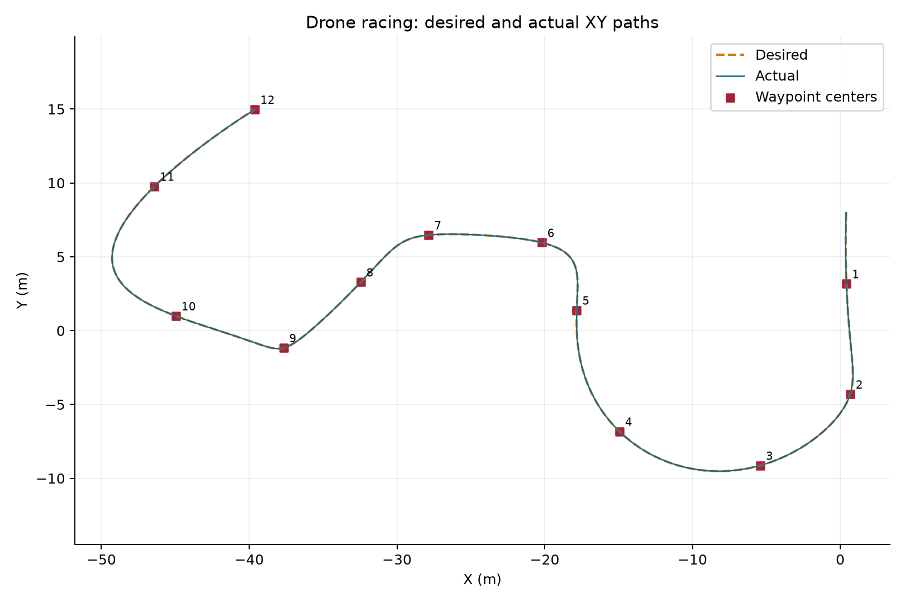
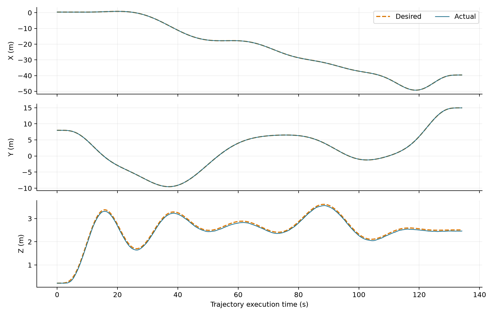
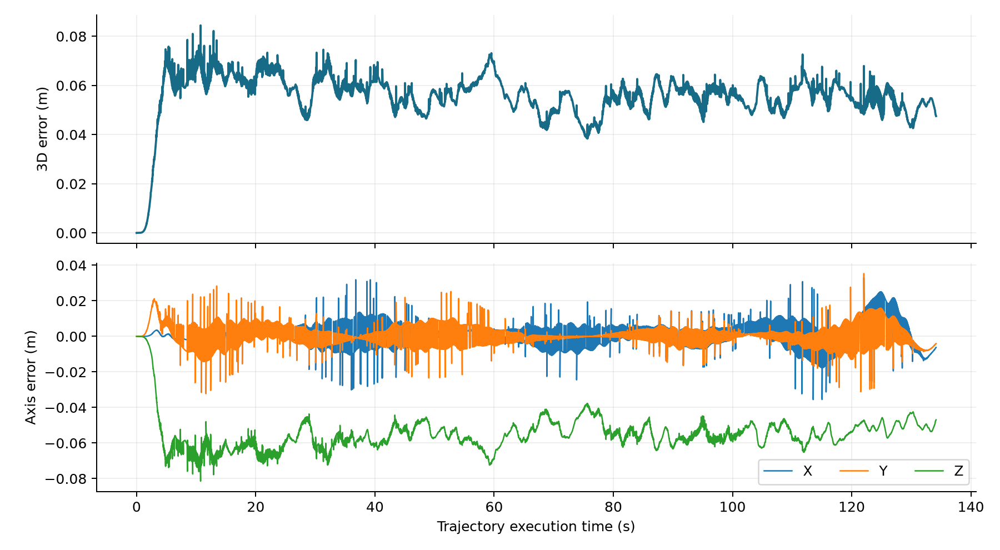

# Lab4 无人机控制与竞速实验报告

| **身份** | **内容** |
| --- | --- |
| 学生 | 黄博宇，24020036026，中外计科一班，第8组 |
| 日期 | 2026年10月22日；原始运行目录标签run_20261022_000059保持不变 |
| 数据依据 | 用户上传的截图、完整源码、视频和ROS1 bag |

## 任务内容

| **任务** | **要解决的问题** | **方法** | **结果** |
| --- | --- | --- | --- |
| 个人D1 | 单段轨迹代价最小化 | QP矩阵与KKT联立 | 完整推导见理论原稿与deliverable_1.pdf |
| 个人D2 | 多段轨迹约束计数 | 变分方程、连续条件和自然条件 | 完整推导见deliverable_2.pdf |
| 团队D3 | 完成首门悬停及全部赛门 | 读取位姿、轨迹优化、时间采样、几何控制 | 用户确认完整通关，连续视频与数据已回传 |
| 可选加速 | 缩短有效通关时间 | 本次未做多轮比较 | 不申报最快团队或加速对比结果 |

## 环境与实现

Ubuntu20.04.6、ROS Noetic、VNAV2021与TESSE Unity场景。位置目标3维，yaw目标1维；N=10表示每段10个系数、最高九次。控制增益kx/kv/kr/komega=2/3/3/1，time_scale=2.0，期望状态每秒发布50次。

Part0提取第一门位姿，速度与加速度置零，发布目标和TF。Part1.1读取实际位置和yaw并等待有效状态。Part1.2把赛门变为顶点约束，位置与yaw分别优化，使用共同段时间并对yaw作连续展开。Part1.3按ROS经过时间采样轨迹，限制到终点后保持末端目标。

实际代码保留Lab3允许的简化，未加入期望角速度前馈。旧controller_pkg/launch/traj_tracking.launch含早期增益，Lab4不启动它，而用planner_pkg/static_point_test.launch和trajectory_generation/traj_following.launch。

## 首门验证

| **方向** | **期望m** | **实际m** | **实际减期望m** |
| --- | --- | --- | --- |
| X | 0.4226201 | 0.4226182 | -0.0000019 |
| Y | 3.1652320 | 3.1652690 | 0.0000370 |
| Z | 2.6700000 | 2.6304210 | -0.0395790 |

这是截图05对应的单次读数，不能当作平均误差。首门画面见[截图04](../data/raw/screenshots/04_Part0首门悬停成功_无人机在第一道赛门附近稳定保持.png)。

## 离线分析方法

使用bag记录时间统一时间轴，对期望位置、速度和展开后的yaw线性插值到实际状态采样时刻。执行起点由运动期间t_record-time_from_start的中位数估计，执行终点加上参考轨迹总时长。主要误差统计只覆盖执行段，不把完成后保持段混入。三维误差e=sqrt(dx^2+dy^2+dz^2)，RMSE=sqrt(mean(e^2))。

## 实测结果

| **指标** | **结果** | **解释** |
| --- | --- | --- |
| 赛门位姿数量 | 12 | 不含代码额外加入的当前起点 |
| bag总时长 | 167.28s | 含准备、执行和保持 |
| 参考轨迹时长 | 134.17s | 非独立裁判认定的竞速成绩 |
| 执行段采样点 | 6708 | 实际状态采样点 |
| 三维RMSE | 0.056426m | 约5.64厘米 |
| 最大位置误差 | 0.084428m | 约8.44厘米 |
| 平均位置误差 | 0.055555m | 实际与期望位置距离的均值 |
| X/Y/Z RMSE | 0.007171/0.006392/0.055602m | 高度方向偏差占主要部分 |
| yaw RMSE | 2.2922° | 角度按最短差统计 |
| 执行段最高速度 | 1.6292m/s | 从实际速度消息计算 |
| 执行路径长度 | 95.570m | 实际采样位置相邻距离求和 |

## 证据与边界

用户确认一次完整通关；8张原始截图、视频、bag、参数和代码均留存。视频160.75秒，未剪辑或加速。上传预览版只缩放和重新编码；149508837字节原视频保存为3个分片，可按SHA256验证并还原。赛门中心最近距离只是几何诊断，不单独构成穿门认证。当前没有多轮最快比较，也没有碰撞传感器裁判记录。

## 交付状态

报告与理论PDF、完整三包源码、原始数据、CSV和图表已准备。题面要求的视频与bag的Drive/Dropbox公开链接尚未提供，不能以GitHub归档冒充该要求。root的rviz_drone_race.txt真实列出GitHub备份，并明确正式平台链接待补。

## 复算与来源

复算入口[data/analysis/analyze_run.py](../data/analysis/analyze_run.py)，指标与全部采样见同目录JSON和CSV。正式PDF由[build_reports.py](build_reports.py)重建；字体有Windows黑体时嵌入，否则使用中文CID字体回退。

来源：[MIT题面](https://vnav.mit.edu/labs_2023/lab4/exercises.html)、[VNAV2021](https://github.com/MIT-SPARK/VNAV-labs/tree/VNAV2021/lab4)、用户上传run_20261022_000059。推导、代码准备、分析和文档使用AI辅助，运行证据来自用户Ubuntu。
